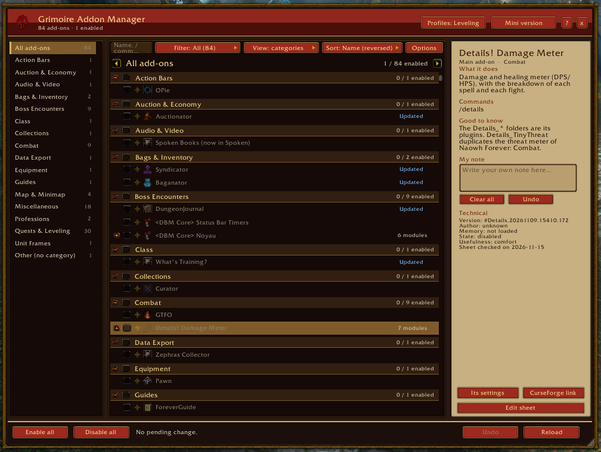

<h1 align="center">📚 Grimoire Addon Manager (GAM) — Wiki</h1>

<b>Choose your language · Choisis ta langue</b>

<a href="en/Getting-started.md">English</a> &nbsp;·&nbsp; <a href="fr/Getting-started.md">Français</a>

## English
| Page | What you will find |
|---|---|
| [🚀 Getting started](en/Getting-started.md) | Install, open, tick then Reload |
| [📖 The window](en/The-window.md) | Columns, filters, sort, search, badges, gestures |
| [📜 Sheets](en/Sheets.md) | Tooltip, sheet parts, your note, editing |
| [🎒 Profiles](en/Profiles.md) | Apply, lock, compare, share, macros, suggestions |
| [⌨️ Commands](en/Commands.md) | Every `/gam` sub-command |
| [⚙️ Options](en/Options.md) | Every option, tab by tab |
| [🐞 Errors and troubleshooting](en/Errors-and-troubleshooting.md) | Error window, memory, CPU, safe mode |
| [❓ FAQ](en/FAQ.md) | Quick answers |
| [🛠️ For developers](en/For-developers.md) | Repository, data files, tools |

## Français
| Page | Ce que tu y trouves |
|---|---|
| [🚀 Prise en main](fr/Getting-started.md) | Installer, ouvrir, cocher puis Recharger |
| [📖 La fenêtre](fr/The-window.md) | Colonnes, filtres, tri, recherche, badges, gestes |
| [📜 Les fiches](fr/Sheets.md) | Infobulle, parties de la fiche, ta note, modifier |
| [🎒 Les profils](fr/Profiles.md) | Appliquer, verrouiller, comparer, partager, macros, propositions |
| [⌨️ Commandes](fr/Commands.md) | Toutes les sous-commandes de `/gam` |
| [⚙️ Options](fr/Options.md) | Toutes les options, onglet par onglet |
| [🐞 Erreurs et dépannage](fr/Errors-and-troubleshooting.md) | Fenêtre des erreurs, mémoire, processeur, mode dépannage |
| [❓ Questions fréquentes](fr/FAQ.md) | Réponses rapides |
| [🛠️ Pour les développeurs](fr/For-developers.md) | Dépôt, fichiers de données, outils |

Code source : [GitHub](https://github.com/Squall98/GrimoireAddonManager) · [CurseForge](https://www.curseforge.com/wow/addons/grimoire-addon-manager) · MIT
