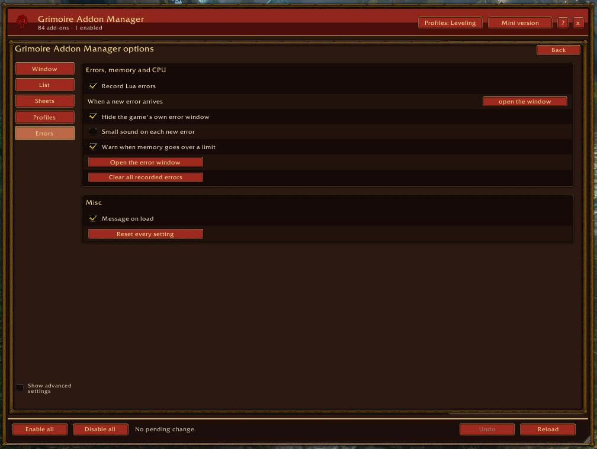

> 🌐 [Lire en français](../fr/Errors-and-troubleshooting.md) · [🏠 Home](../Home.md)

# 🐞 Errors and troubleshooting

*The Errors tab of the options.*

## 🐞 The error window
GAM catches the Lua errors of **all** your add-ons. Open the window with `/gam errors`.
- Errors are grouped **by add-on**, with the date, how many times, the file and the line.
- Pick one to read its full call stack (the path that led to the error).
- **Copy** copies one error, **Copy all** every one: paste it to whoever helps you.
- **Clear** empties the list (`/gam errors clear`).
- The minimap button shows a small **red counter** when there are errors.
- What happens on a new error (window, one chat line, nothing), a sound, and hiding the game's own red window: Options › Errors.

## 🧠 Memory
`/gam memory` ranks add-ons from the hungriest to the lightest. GAM also **warns** you when the total or one add-on goes over a limit (Options › Errors, advanced).

## ⏱️ CPU
1. `/gam cpu on`, then `/reload` (the game runs a little slower while measuring).
2. Play for a while.
3. `/gam cpu` shows the ranking. `/gam cpu reset` starts again.
4. When done: `/gam cpu off` and `/reload`.

## 🔎 Safe mode: find the add-on that breaks everything
1. `/gam safe` turns everything off except GAM and your locked add-ons. You can name the ones to keep: `/gam safe Questie Baganator`.
2. `/reload` and test. Problem gone? Turn half of your add-ons back on, reload, and repeat with the guilty half.
3. `/gam back` puts **everything exactly as it was**, even after several reloads. Reload again.

## 🧪 Trial
`/gam trial AddonName` turns an add-on on for **one session only**: it turns itself off at the next login. It gets a *Trial* badge. `/gam trial` alone lists them.

## ⏳ Out-of-date add-ons
An add-on made for another game version is marked “outdated” and not loaded. To load it anyway, at your own risk: `/gam outdated on` (then reload); `/gam outdated off` to stop.

## 🩺 `/gam diag` and `/gam trace`
Tools for whoever fixes GAM:
- `/gam diag` checks what the game can do (functions, images, settings) and records the result.
- `/gam trace` records where each part of the window is at every click, for debugging; type it again to stop.

Both write to your saved variables at the next `/reload` or logout; hand that log to the person helping you.

## 🧰 Common problems
| Problem | What to do |
|---|---|
| The window does not open | Check GAM is ticked on the character screen; try `/maa` or `/mesaddons` (another add-on may have taken `/gam`); use the minimap button or Esc › AddOns; if it says “outdated”, tick *Load out of date AddOns* on the add-ons screen. Check that the folder is `AddOns\GrimoireAddonManager\GrimoireAddonManager.toc` (no extra folder in between). |
| I ticked but nothing changed | Click **Reload**. This is normal. |
| An add-on does not load | Read the reason on its row (missing dependency, outdated, not for Forever). Shift + click on its box turns on dependencies too. |
| The game is slow | `/gam memory`, then `/gam cpu on`. Turn off the big eaters, or make a “light” profile. |
| The window looks bad | Options › Window: text size; Options › Sheets: sheet background “plain”; advanced: *Forget saved sizes*. |
| A profile turned off something I need | `/gam undo` before reloading. For good: lock that add-on, or add it to the profile and *Keep current setup here*. |

Still stuck? See the [FAQ](FAQ.md).
