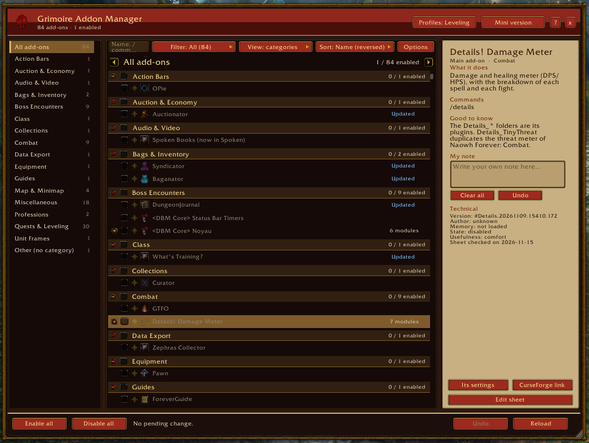
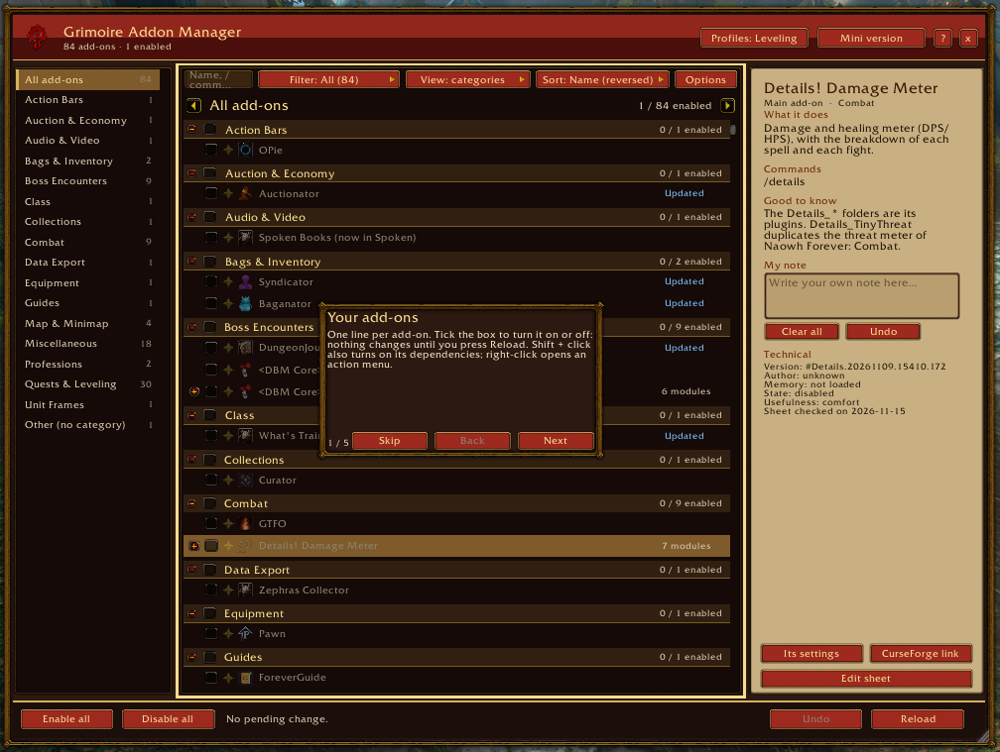

> 🌐 [🇫🇷 Lire en français](../fr/Getting-started.md) · [🏠 Home](../Home.md)

# 🚀 Getting started

*The Grimoire window: categories on the left, your add-ons in the middle, the sheet on the right.*

## 📥 Install
- **CurseForge** (easiest): search for *Grimoire Addon Manager*.
- **By hand**: download the latest zip and copy the `GrimoireAddonManager` folder into `World of Warcraft\_forever_\Interface\AddOns\`.
- Start the game and check on the character screen (AddOns button) that **Grimoire Addon Manager** is ticked.

Your settings, profiles and notes are kept by the game in `WTF\Account\…\SavedVariables\`, **not** in the add-on folder: updating or reinstalling GAM never erases them.

## 📖 Open the window
Pick whichever you like:
- type **/gam** in the chat (`/maa` and `/mesaddons` do the same; you can change these names in [Options](Options.md));
- click the **round button near the minimap** (drag it to move it);
- open the game's **Esc menu** and click the **AddOns** button;
- give it a key: Esc › Key Bindings › AddOns › *Grimoire Addon Manager* (five keys: window, profiles, reload, cheat sheet, mini version).

## ✅ Tick, then Reload
1. **Tick** the box of an add-on to turn it on, **untick** it to turn it off.
2. Nothing really changes yet. The game can only load or unload add-ons when the interface restarts.
3. Click **Reload** at the bottom. The button lights up (with a counter) as soon as something is waiting.
4. Changed your mind? **Undo** (before reloading) takes the last change back.

> 💡 “Ticked” means *will be on after the next reload*. “Loaded” means *running right now*. The row says it in plain words.

## 🧭 First steps
- Hover an add-on: a short summary appears. Click it: its full [sheet](Sheets.md) opens on the right.
- Press **Profiles** at the top to switch a whole set of add-ons at once ([Profiles](Profiles.md)).
- Press **?** at the top for the cheat sheet of every command; type `/gam tour` for the 5-bubble guided tour.

*The guided tour shows the main parts of the window in 5 bubbles.*

Next: [The window](The-window.md).
