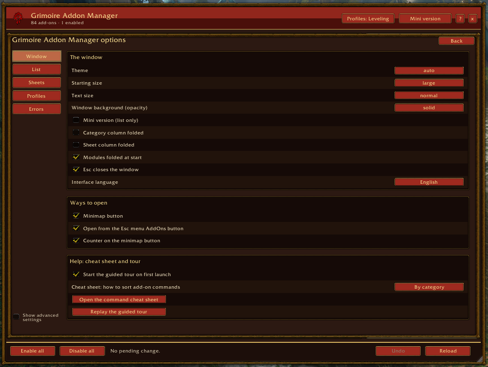
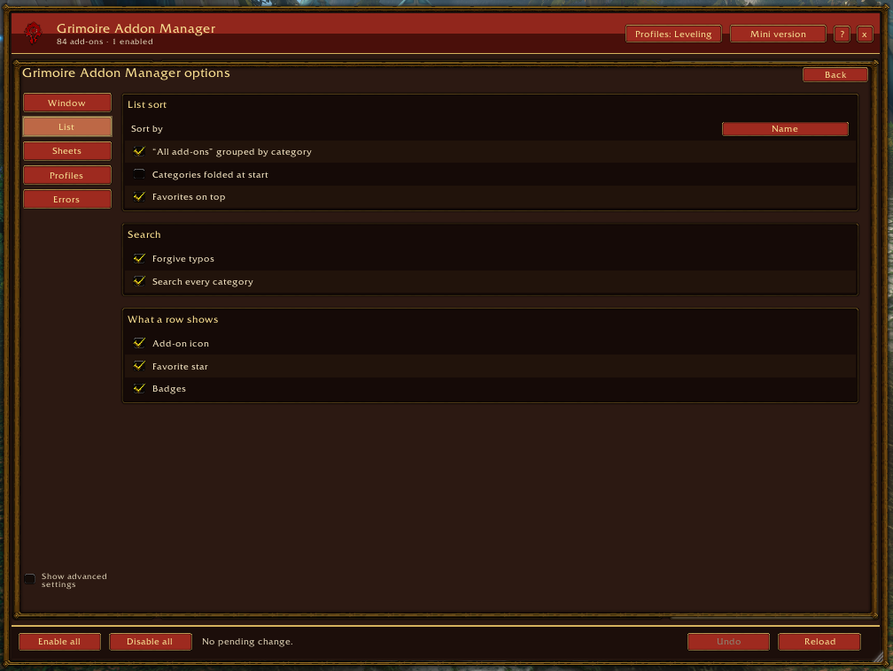
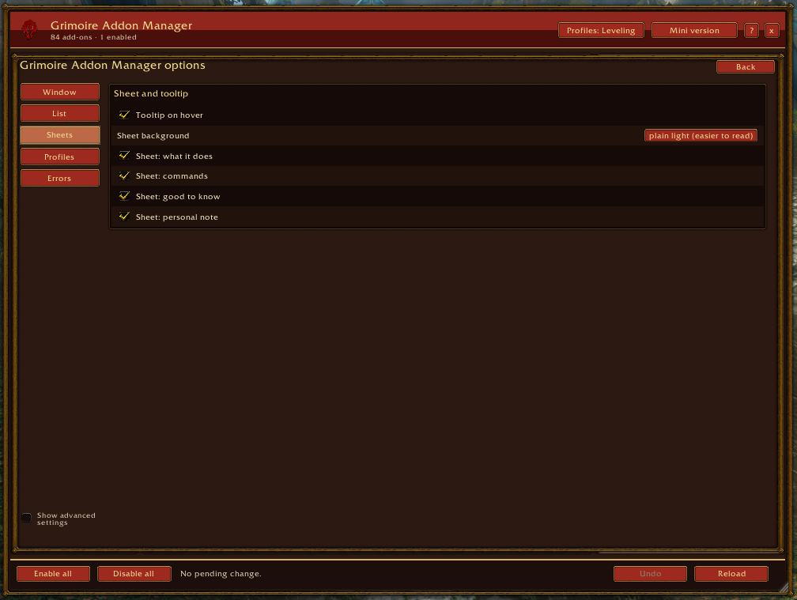
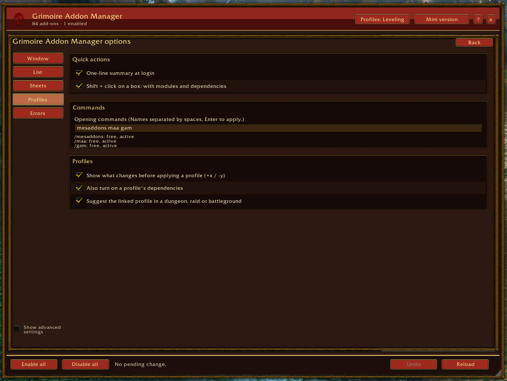
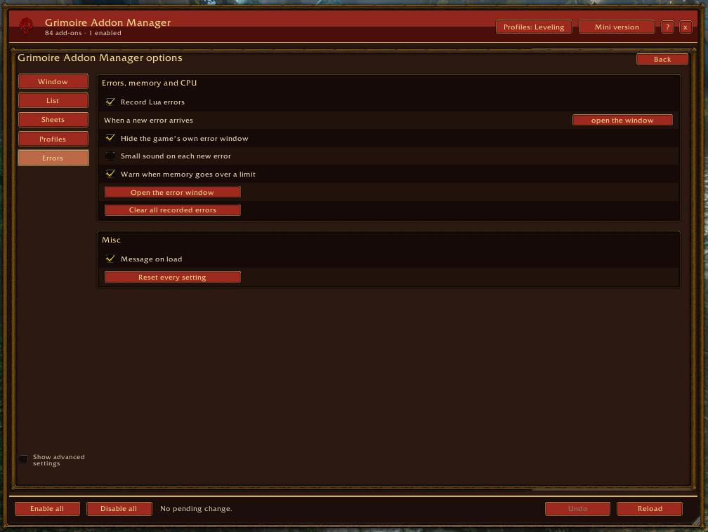

> 🌐 [🇫🇷 Lire en français](../fr/Options.md) · [🏠 Home](../Home.md)

# ⚙️ Options

Everything below is generated from the add-on's data files. Options marked 🔧 only appear when you tick **Show advanced settings** at the top of the options panel.

> 📍 Open them with the **Options** button of the window, `/gam options`, or the game's Esc menu › Options › AddOns (`/gam options game`).

## 🪟 Window

### The window

| Option | What it does | Default | Advanced |
|---|---|---|---|
| Theme | Colours of the window. “auto” follows your character's faction (red and gold for Horde, blue for Alliance). **Choices:** auto, horde, alliance, neutral. | auto | — |
| Starting size | Size the window has the first time you open it (you can still drag its bottom-right corner). **Choices:** large, medium, compact. | large | — |
| Text size | Makes all the text of the window smaller or bigger. **Choices:** small, normal, large. | normal | — |
| Font | Typeface used in the window: the game's own, a gothic one or Cinzel. **Choices:** game, gothic, cinzel. | game | 🔧 yes |
| Window background (opacity) | How see-through the window background is. **Choices:** solid, 85%, 70%, see-through (50%). | solid | — |
| Mini version (list only) | Shows only the list, for quick ticking. Same as the Mini version button in the header. | ⬜ off | — |
| Category column folded | Folds the left column (categories). Same as the arrow in the banner. | ⬜ off | — |
| Sheet column folded | Folds the right column (the sheet). Same as the arrow in the banner. | ⬜ off | — |
| Undo steps kept | How many changes the Undo button can take back. (from 1 to 20) | 5 | 🔧 yes |
| Modules folded at start | Add-on modules (the small parts of a big add-on) start hidden under their main add-on. | ✅ on | — |
| Esc closes the window | Pressing Esc closes the window. | ✅ on | — |
| Interface language | Language of the interface. “auto” follows the game's language. **Choices:** auto, Français, English. | auto | — |
| 🔘 Forget saved sizes | Forgets the saved size and place of the windows. | (button) | 🔧 yes |

### Ways to open

| Option | What it does | Default | Advanced |
|---|---|---|---|
| Minimap button | Shows the round button near the minimap. Click: open; right-click: menu; drag: move it. | ✅ on | — |
| Open from the Esc menu AddOns button | The “AddOns” button of the game's Esc menu opens GAM. | ✅ on | — |
| Button position (degrees) | Where the button sits around the minimap, in degrees (dragging it changes this too). (from 0 to 359) | 200 | 🔧 yes |
| Counter on the minimap button | Small red counter on the button when there are errors (or changes waiting). | ✅ on | — |
| Right-click on the button | What a right-click on the minimap button does. **Choices:** Menu (profiles and tools), Reload when changes are pending. | Menu (profiles and tools) | 🔧 yes |
| Profiles in the button's menu | Lists your profiles in the button's right-click menu. | ✅ on | 🔧 yes |

### Help: cheat sheet and tour

| Option | What it does | Default | Advanced |
|---|---|---|---|
| Start the guided tour on first launch | Starts the 5-bubble guided tour the first time. It runs only once. | ✅ on | — |
| Cheat sheet content when opened | What the cheat sheet shows when opened: everything, only GAM's commands, or only your add-ons'. **Choices:** Everything, This manager, Installed add-ons. | Everything | 🔧 yes |
| Cheat sheet: how to sort add-on commands | How the add-ons' commands are arranged in the cheat sheet. **Choices:** By category, One tab per add-on. | By category | — |
| Shift + click on a cheat-sheet command: run it | Shift + click on a command in the cheat sheet runs it instead of only typing it. | ✅ on | 🔧 yes |
| Also show commands of turned-off add-ons | Also lists commands of add-ons that are turned off. | ✅ on | 🔧 yes |
| Spot commands the sheets do not mention | Finds commands that add-ons register but the sheets do not mention. | ✅ on | 🔧 yes |
| 🔘 Open the command cheat sheet | Opens the command cheat sheet. | (button) | — |
| 🔘 Replay the guided tour | Plays the guided tour again. | (button) | — |

## 📋 List

### List sort

| Option | What it does | Default | Advanced |
|---|---|---|---|
| Sort by | How the list is sorted. Click the sort button to change it; right-click to reverse. **Choices:** Name, Category, State, Memory, Usefulness. | Name | — |
| Reverse order | Reverses the sort order. | ⬜ off | 🔧 yes |
| “All add-ons” grouped by category | In “All add-ons”, groups the add-ons by category in folding sections (off = one plain list). | ✅ on | — |
| Categories folded at start | Category sections start folded. | ⬜ off | — |
| Favorites on top | Favourites (star) stay at the top of the list. | ✅ on | — |
| New ones on top | Add-ons that just arrived come first. | ✅ on | 🔧 yes |
| "New" only without a sheet | Only add-ons without a sheet get the “New” badge. | ✅ on | 🔧 yes |

### Choices in the Filter list

| Option | What it does | Default | Advanced |
|---|---|---|---|
| In the Filter list: “All” | Keeps the “All” choice in the window's Filter drop-down list. | ✅ on | 🔧 yes |
| In the Filter list: “Enabled” | Keeps the “Enabled” choice in the window's Filter drop-down list. | ✅ on | 🔧 yes |
| In the Filter list: “Disabled” | Keeps the “Disabled” choice in the window's Filter drop-down list. | ✅ on | 🔧 yes |
| In the Filter list: “Outdated” | Keeps the “Outdated” choice in the window's Filter drop-down list. | ✅ on | 🔧 yes |
| In the Filter list: “Duplicates” | Keeps the “Duplicates” choice in the window's Filter drop-down list. | ✅ on | 🔧 yes |
| In the Filter list: “No sheet” | Keeps the “No sheet” choice in the window's Filter drop-down list. | ✅ on | 🔧 yes |
| In the Filter list: “Favorites” | Keeps the “Favorites” choice in the window's Filter drop-down list. | ✅ on | 🔧 yes |
| In the Filter list: “To remove” | Keeps the “To remove” choice in the window's Filter drop-down list. | ⬜ off | 🔧 yes |
| In the Filter list: “New” | Keeps the “New” choice in the window's Filter drop-down list. | ✅ on | 🔧 yes |
| In the Filter list: “Updated” | Keeps the “Updated” choice in the window's Filter drop-down list. | ⬜ off | 🔧 yes |
| In the Filter list: “Errors” | Keeps the “Errors” choice in the window's Filter drop-down list. | ⬜ off | 🔧 yes |
| In the Filter list: “On trial” | Keeps the “On trial” choice in the window's Filter drop-down list. | ⬜ off | 🔧 yes |
| In the Filter list: “Changed” | Keeps the “Changed” choice in the window's Filter drop-down list. | ⬜ off | 🔧 yes |

### Search

| Option | What it does | Default | Advanced |
|---|---|---|---|
| Search the name | The search looks in add-on names. | ✅ on | 🔧 yes |
| Search the sheet | The search looks in the sheets' text. | ✅ on | 🔧 yes |
| Search my note | The search looks in your personal notes. | ✅ on | 🔧 yes |
| Search the commands | The search looks in the add-ons' commands (e.g. /way). | ✅ on | 🔧 yes |
| Search the tags | The search looks in tags (#pvp…). | ✅ on | 🔧 yes |
| Search the add-on's own text | The search looks in the description the add-on gives about itself. | ✅ on | 🔧 yes |
| Search the category | The search looks in category names. | ✅ on | 🔧 yes |
| Forgive typos | Small typos still find the add-on (“Questei” finds Questie). | ✅ on | — |
| Typos allowed per word | How many wrong letters are forgiven in one word. (from 0 to 3) | 1 | 🔧 yes |
| Minimum length to forgive | Words shorter than this must be typed exactly. (from 2 to 8) | 4 | 🔧 yes |
| Search every category | A search looks in every category, not only the one you selected. | ✅ on | — |
| Best matches first | The best matches come first instead of following the normal sort. | ✅ on | 🔧 yes |
| Keep the search after a reload | Keeps what you typed in the search box after a reload. | ⬜ off | 🔧 yes |

### What a row shows

| Option | What it does | Default | Advanced |
|---|---|---|---|
| Add-on icon | Shows each add-on's icon on its row. | ✅ on | — |
| Favorite star | Shows the favourite star on each row. | ✅ on | — |
| Badges | Shows the badges (new, error…) on each row. | ✅ on | — |
| Why it is not loaded | Says in plain words why an add-on is not loaded (missing dependency, out of date…). | ✅ on | 🔧 yes |
| Also say "loaded" or "disabled" | Also writes “loaded” or “disabled” on each row. | ⬜ off | 🔧 yes |
| Memory used | Shows the memory each add-on uses on its row. | ⬜ off | 🔧 yes |
| Badges per row (at most) | Most badges drawn on one row (0 = none). (from 0 to 6) | 2 | 🔧 yes |
| Tags per add-on (at most) | Most tags you can give to one add-on. (from 1 to 20) | 8 | 🔧 yes |

### Badges

| Option | What it does | Default | Advanced |
|---|---|---|---|
| "New" badge | Badge for an add-on that just arrived in your AddOns folder. | ✅ on | 🔧 yes |
| "Updated" badge | Badge for an add-on whose version changed since last time. | ✅ on | 🔧 yes |
| "Error" badge | Badge for an add-on that caused at least one Lua error. | ✅ on | 🔧 yes |
| "Duplicate" badge | Badge when another turned-on add-on does the same job. | ✅ on | 🔧 yes |
| "Unused" badge | Badge for an add-on not made for WoW Forever (greyed out). | ✅ on | 🔧 yes |
| "Trial" badge | Badge for an add-on turned on for this session only. | ✅ on | 🔧 yes |
| "To remove" badge | Badge for an add-on in your “to remove” list (a reminder only). | ✅ on | 🔧 yes |
| "Locked" badge | Badge for a locked add-on (no profile will turn it off). | ✅ on | 🔧 yes |
| 🔘 Mark everything as seen | Removes the “New” and “Updated” badges from every add-on. | (button) | 🔧 yes |

## 📜 Sheets

### Sheet and tooltip

| Option | What it does | Default | Advanced |
|---|---|---|---|
| Tooltip on hover | Shows a short summary in a tooltip when you hover an add-on. | ✅ on | — |
| Sheet background | Background of the sheet: plain light (easiest to read) or the game's parchment texture. **Choices:** game parchment, plain light (easier to read). | plain light (easier to read) | — |
| Sheet: what it does | Shows the “what it is for” part of the sheet. | ✅ on | — |
| Sheet: commands | Shows the add-on's own commands in the sheet. | ✅ on | — |
| Sheet: good to know | Shows the “good to know” part (pitfalls, settings to do). | ✅ on | — |
| Sheet: personal note | Shows your personal note box in the sheet. | ✅ on | — |
| Sheet: technical | Shows version, author, memory and state. | ✅ on | 🔧 yes |
| Sheet: dependencies | Shows the add-ons this one needs, and whether they are there and on. | ✅ on | 🔧 yes |
| Sheet: duplicates | Shows turned-on add-ons that do the same job. | ✅ on | 🔧 yes |
| Sheet: badges | Shows the same badges as on the row. | ✅ on | 🔧 yes |
| Note length | Longest personal note, in characters. (from 100 to 5000) | 1000 | 🔧 yes |
| Sheet text length | Longest text you can write when editing a sheet, in characters. (from 100 to 5000) | 800 | 🔧 yes |

## 🎒 Profiles

### Profiles

| Option | What it does | Default | Advanced |
|---|---|---|---|
| Show what changes before applying a profile (+x / -y) | Before applying a profile, shows what changes: +x to turn on, −y to turn off. | ✅ on | — |
| Also turn on a profile's dependencies | A profile also turns on the dependencies its add-ons need. | ✅ on | — |
| Also turn on optional dependencies (e.g. Baganator turns on Syndicator) | Also turns on optional dependencies (e.g. Baganator brings Syndicator). | ⬜ off | 🔧 yes |
| Apply a profile to | Who a profile is applied to by default: this character or all known ones. **Choices:** This character, All characters. | This character | 🔧 yes |
| Suggest the linked profile in a dungeon, raid or battleground | Offers the matching profile when you enter a dungeon, raid or battleground. Never automatic: it asks first and waits for the end of combat. | ✅ on | — |
| Wait (seconds) before suggesting | Seconds to wait after entering before suggesting. (from 0 to 30) | 3 | 🔧 yes |
| Profile suggested in a dungeon (name) | Name of the profile suggested in a dungeon. | `donjon` | 🔧 yes |
| Profile suggested in a raid (name) | Name of the profile suggested in a raid. | `donjon` | 🔧 yes |
| Profile suggested in a battleground (name) | Name of the profile suggested in a battleground or arena (empty = no suggestion). | (empty) | 🔧 yes |

### Quick actions

| Option | What it does | Default | Advanced |
|---|---|---|---|
| One-line summary at login | Prints one line in the chat at login: add-ons, profile, pending changes, errors. | ✅ on | — |
| Shift + click on a box: with modules and dependencies | Shift + click on a box also turns on the add-on's modules and dependencies. | ✅ on | — |
| Say which trials are ending | At login, says which trial add-ons have just been turned off. | ✅ on | 🔧 yes |

### Commands

| Option | What it does | Default | Advanced |
|---|---|---|---|
| Opening commands | The words that open the window (/gam, /maa, /mesaddons…), separated by spaces. A name already used by another add-on is refused. | /mesaddons /gam /maa | — |
| Bare command | What typing the command with nothing after it does: open the window, show help or open the options. **Choices:** open, help, options. | open | 🔧 yes |

## 🐞 Errors

### Errors, memory and CPU

| Option | What it does | Default | Advanced |
|---|---|---|---|
| Record Lua errors | Catches Lua errors from all add-ons and keeps their details. | ✅ on | — |
| When a new error arrives | What happens when a new error arrives: open the error window, one chat line, or nothing. **Choices:** open the window, one line in the chat, nothing (count silently). | open the window | — |
| Seconds between two notices | Minimum wait between two notices, so you are not flooded. (from 0 to 120) | 10 | 🔧 yes |
| Hide the game's own error window | Hides the game's red error window; the errors stay recorded here. | ✅ on | — |
| Small sound on each new error | Plays a small sound on each new error. | ⬜ off | — |
| Different errors kept | How many different errors are kept (the oldest go first). (from 10 to 500) | 100 | 🔧 yes |
| Characters kept of the message | Characters kept of each error message. (from 100 to 2000) | 500 | 🔧 yes |
| Characters kept of the call stack | Characters kept of each error's call stack (the path that led to it). (from 200 to 6000) | 1800 | 🔧 yes |
| Rows in the error list | Rows shown in the error window's list. (from 5 to 20) | 10 | 🔧 yes |
| Warn when memory goes over a limit | Warns you when memory use goes over the limits below. | ✅ on | — |
| Total memory limit (MB) | Warning limit for the memory of all add-ons together. (from 100 to 4000) | 500 | 🔧 yes |
| Memory limit per add-on (MB) | Warning limit for a single add-on. (from 10 to 1000) | 80 | 🔧 yes |
| Seconds between two measures | How often memory is measured. (from 10 to 600) | 60 | 🔧 yes |
| Seconds before repeating a warning | Wait before the same warning is repeated. (from 60 to 3600) | 900 | 🔧 yes |
| Rows of the memory command | Rows printed by /gam memory. (from 3 to 50) | 10 | 🔧 yes |
| Remind me that measuring mode is on | Reminds you that CPU measuring is on (it slows the game a little). | ✅ on | 🔧 yes |
| Rows of the CPU command | Rows printed by /gam cpu. (from 3 to 50) | 10 | 🔧 yes |
| 🔘 Open the error window | Opens the error window. | (button) | — |
| 🔘 Clear all recorded errors | Deletes every recorded error. | (button) | — |

### Log and characters

| Option | What it does | Default | Advanced |
|---|---|---|---|
| Log on | Turns the add-on's own log on (a diary of what GAM did). | ✅ on | 🔧 yes |
| Lines kept | How many log lines are kept. (from 50 to 1000) | 200 | 🔧 yes |
| Minimum level | Lowest importance written in the log: debug, info, warning or error. **Choices:** debug, info, warning, error. | info | 🔧 yes |
| Merge identical lines | Identical lines in a row are merged into one with a counter. | ✅ on | 🔧 yes |
| Record Lua errors | Also writes Lua errors in the log. | ✅ on | 🔧 yes |
| Lines shown in chat | How many log lines the /gam log command prints in the chat. (from 1 to 50) | 10 | 🔧 yes |
| Remember my characters | Remembers your characters so a profile can be applied to all of them. | ✅ on | 🔧 yes |
| 🔘 Clear the log | Empties the log. | (button) | 🔧 yes |

### Misc

| Option | What it does | Default | Advanced |
|---|---|---|---|
| Message on load | Prints a short “loaded” message in the chat when the game starts. | ✅ on | — |
| Prefix color (hex) | Colour of the [GAM] prefix in chat messages, 6 hex digits (e.g. ffd100). | `ffd100` | 🔧 yes |
| 🔘 Reset every setting | Puts every setting back to its starting value (asks to confirm). | (button) | — |
