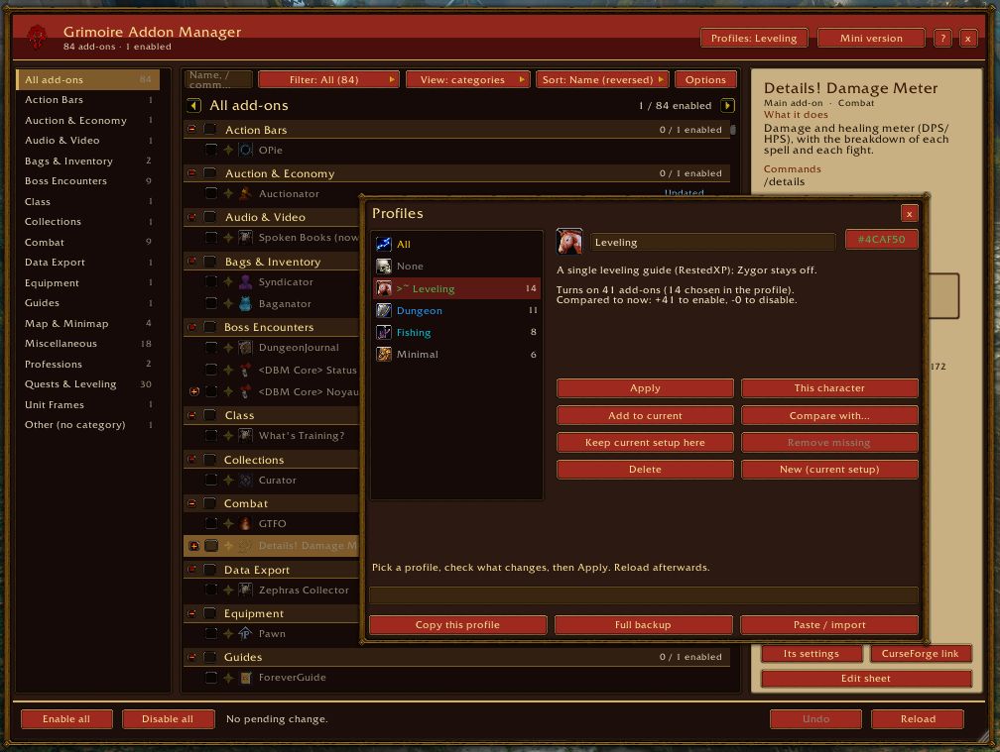

> 🌐 [🇫🇷 Lire en français](../fr/Profiles.md) · [🏠 Home](../Home.md)

# 🎒 Profiles

A profile is a list of add-ons to turn on together. Profiles are shared by all your characters; when you apply one you choose **This character** or **All characters**.

*The profiles window: the list on the left, what the profile turns on, and what changes.*

## 🎁 Ready-made profiles
- **Leveling**, **Dungeon**, **Fishing**, **Minimal**;
- **All** and **None**: always there, cannot be deleted.

Only add-ons you really have installed are kept; modules follow their main add-on. `/gam profile ready` re-creates the ready-made ones if you deleted them.

## ▶️ Apply a profile
1. Click **Profiles** at the top of the window (or `/gam profiles`).
2. Pick a profile: the window shows what it turns on and **what changes: +x to turn on, −y to turn off**.
3. Choose **This character** or **All characters**, then **Apply** (a confirmation shows the +x / −y again).
4. Click **Reload**. That is when the add-ons really change.

To keep the current setup as a new profile: **New (current setup)**. To update a profile with the current setup: **Keep current setup here**. You can also rename, delete and clean a profile (clean removes add-ons you uninstalled since).

## 🔒 Locks
**Lock** an add-on (right-click › Lock, or `/gam lock Name`): no profile will ever turn it off.

## 🔗 Dependencies
A profile also turns on the dependencies its add-ons need. Optional dependencies (e.g. Baganator brings Syndicator) are an advanced option.

## ⚖️ Compare two profiles
`/gam profile compare Dungeon / Leveling` says what is only in one, only in the other, and in both.

## 📋 Copy and paste (MAA1)
- **Copy this profile** gives one line of text starting with **MAA1**. Send it to a friend.
- Your friend uses **Paste / import** (or `/gam profile import MAA1:…`).
- `/gam profile backup` writes **everything** (profiles, locks, notes, tags, favourites) in one line: keep it somewhere safe.

## 🎛️ More profile commands
| Command | What it does |
|---|---|
| `/gam profile <name>` | Apply to this character |
| `/gam profile all <name>` | Apply to all known characters |
| `/gam profile merge <name>` | Add its add-ons, turn nothing off |
| `/gam profile compare A / B` | Compare two profiles |
| `/gam profile new <name>` | New profile from the current setup |
| `/gam profile save <name>` | Replace a profile with the current setup |
| `/gam profile rename old / new` | Rename |
| `/gam profile delete <name>` | Delete (cannot be undone) |
| `/gam profile export <name>` | One line of MAA1 text |

Words in French (`/gam profil tous Donjon`…) work too. See [Commands](Commands.md).

## ⚡ Switch without opening the window
- **Right-click the minimap button**: the list of profiles.
- **A macro**: create a game macro containing `/gam profile Dungeon`, then `/gam reload` when ready.
- **A key**: bind *Profiles* or *Reload* in Key Bindings.

## 🏰 Suggestion in a dungeon, raid or battleground
When you enter one, GAM can **suggest** the linked profile. It never applies it by itself, and it waits for the end of combat. Choose which profile goes with which place in Options › Profiles (advanced).

Next: [Commands](Commands.md).
