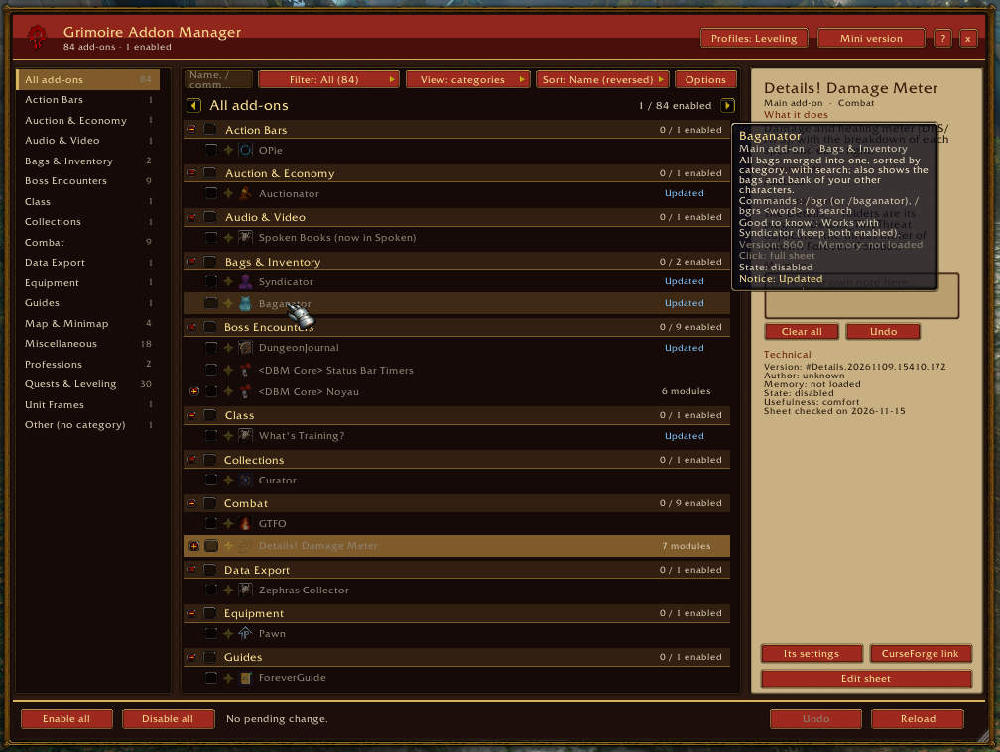
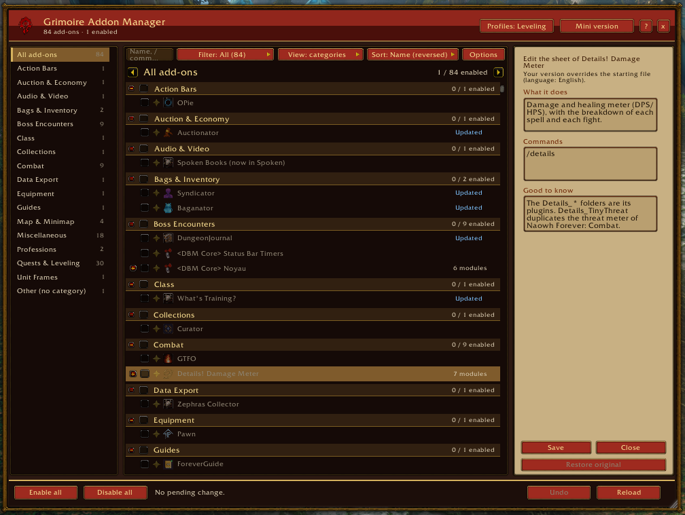

> 🌐 [🇫🇷 Lire en français](../fr/Sheets.md) · [🏠 Home](../Home.md)

# 📜 Sheets and tooltips

GAM ships with **102 sheets**: for each well-known add-on, what it does, its commands and what to know. You will never again wonder “what was this one for?”.

*Hover an add-on: a short summary.*

## 💬 The tooltip
Hover a row to see the summary and the state. You can turn it off in Options › Sheets › *Tooltip on hover*.

## 📜 The sheet
Click a row: the sheet opens on the right.

| Part | What it says |
|---|---|
| **What it does** | One or two sentences. |
| **Commands** | The add-on's own commands (e.g. `/way` for TomTom). |
| **Good to know** | Pitfalls, settings to do, what does not work on Forever. |
| **Your note** | Free text, saved with your settings. |
| **Technical** | Version, author, memory, state. |
| **Dependencies** | The add-ons it needs, and whether they are there and on. |
| **Duplicates** | Turned-on add-ons doing the same job. |
| **Badges** | The same as on the row. |

Each part can be shown or hidden in Options › Sheets.

An add-on **without a sheet** shows its own description instead. `/gam nosheet` lists them.

## ✍️ Your note
Type in the note area (“Write your own note here…”). It is saved automatically and the search can find it.
- **Clear all** empties the note; **Undo** puts it back.
- Maximum length: Options › Sheets (advanced).

## ✏️ Edit a sheet

Click **Edit sheet** under the sheet: change the text, commands and remarks. Your version wins over the shipped one. **Restore original** brings the original back.

## 🔗 Links
- **Its settings** opens the add-on's own settings page (if it is loaded).
- **CurseForge link** shows its address to copy (the game cannot open a web browser).

Sheets, categories and profiles shipped with GAM live in data files: see [For developers](For-developers.md) to add your own for everyone.

Next: [Profiles](Profiles.md).
