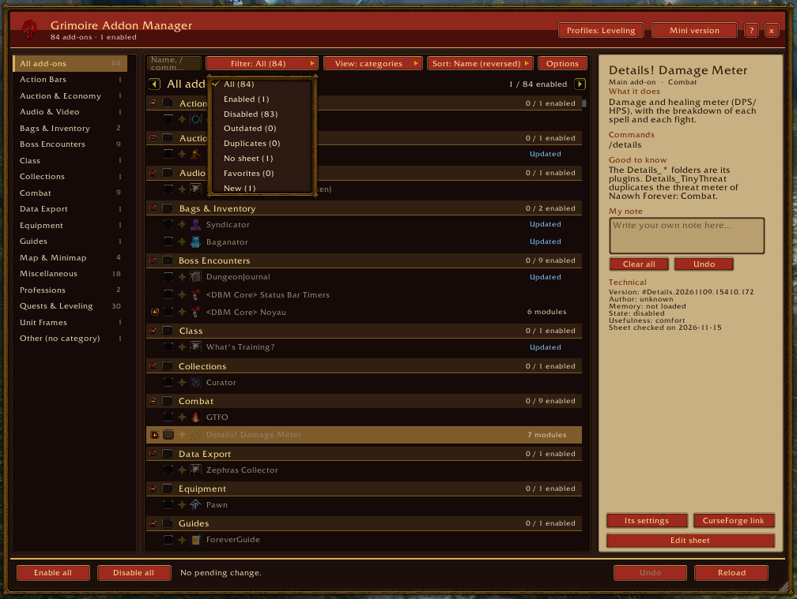
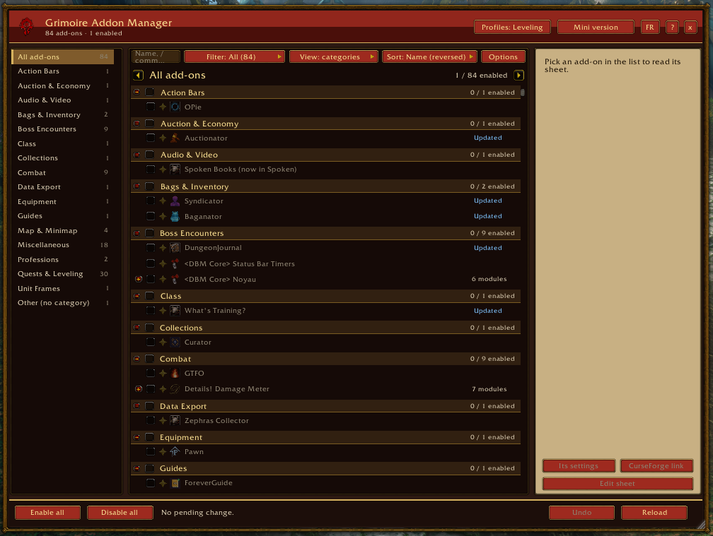
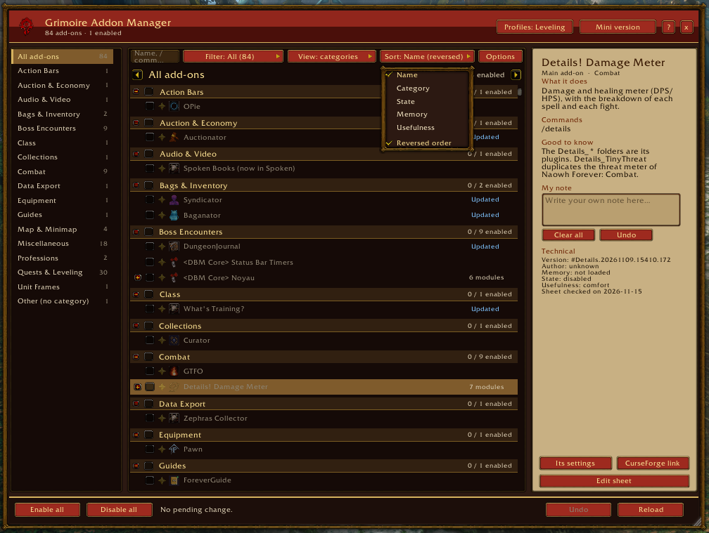
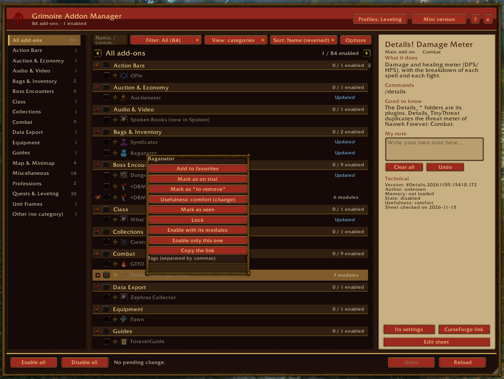
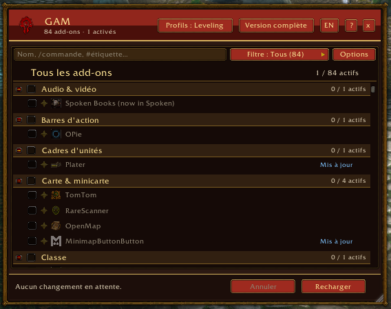

> 🌐 [🇫🇷 Lire en français](../fr/The-window.md) · [🏠 Home](../Home.md)

# 📖 The window

*Filter list, sort button and view button in the top bar.*

## 🧩 The three columns
| Column | What it holds |
|---|---|
| **Left** | The categories (maps, combat, bags…). Click one to filter the list. Add-ons without a sheet go in “Other”. |
| **Middle** | Your add-ons, one row each: tick box, icon, name, favourite star, badges, and the state in plain words. |
| **Right** | The [sheet](Sheets.md) of the add-on you clicked. |

The **arrows « and »** in the banner fold the left or the right column to give the list more room. A second click puts it back, and the game remembers.

## 🪟 The top of the window
- **Header**: name, number of add-ons and how many are on. Drag it to move the window; drag the bottom-right corner to resize.
- **Language button** (shows **FR** or **EN**, the language you switch to): one click changes the language and reloads the interface.

*The window in English, with the **FR** button to go back to French.*

- **Profiles**, **Mini version**, **?** (cheat sheet) and **✕** to close. **Options** is at the right of the bar under the title.
- Esc also closes the window (you can turn that off).

## 🗂️ Categories view or list view
The **View** drop-down list lets you pick:
- **View: categories**: “All add-ons” grouped by category in folding sections;
- **View: list**: one plain list.

## 🔍 Filter, sort, search
- **Filter** (drop-down list): All, Enabled, Disabled, Outdated, Duplicates, No sheet, Favourites, New… You choose which entries the list offers in [Options](Options.md).
- **Sort** (drop-down list): name, category, state, memory or usefulness; **Reversed order** at the bottom of the list.
- **Search box**: type a few letters.
  - Forgives typos (“Questei” finds Questie).
  - Looks in names, sheets, your notes, commands and tags.
  - `/way` finds the add-ons that have that command.
  - `#pvp` finds the add-ons tagged *pvp*.
  - Several words work together.

*The sort choices.*

## ⭐ Favourites, tags and badges
- Click the **star** to make a favourite; favourites stay on top (an option).
- Give an add-on **tags** from its right-click menu (separated by commas), then search `#tag`.
- **Badges** on a row:

| Badge | Meaning |
|---|---|
| New | Just arrived in your AddOns folder |
| Updated | Its version changed |
| Error | It caused at least one Lua error |
| Duplicate | Another turned-on add-on does the same job |
| Unused | Not made for WoW Forever (greyed out) |
| Trial | On for this session only |
| To remove | In your “to remove” list (a reminder: GAM cannot delete anything) |
| Locked | No profile will turn it off |

## 🖱️ Mouse gestures
| Gesture | Effect |
|---|---|
| Click a box | Turns the add-on on/off (after Reload) |
| **Shift + click** a box | Turns it on **with its modules and dependencies** |
| Click a row | Opens its sheet |
| Hover a row | Tooltip with the summary and state |
| **Right-click** a row | Quick-action menu |
| Click the star | Favourite on/off |
| Click / right-click the sort button | Change sort / reverse |
| Click the minimap button | Open or close; drag to move it |
| Right-click the minimap button | Menu: profiles, reload, safe mode, outdated |

## 📋 The right-click menu

It offers: add to / remove from favourites, mark as trial, mark as “to remove”, usefulness level, mark as seen, tags, **Lock / Unlock**, **Enable with its modules**, **Enable only this one**, **Copy the link**.

## 🔘 The bottom buttons
- **Enable all**: ticks every add-on made for the game (then Reload).
- **Disable all**: unticks everything except GAM (then Reload).
- **Undo**: takes the last change back (how many steps it remembers is an option).
- **Reload**: applies everything.

Both “all” buttons can be undone.

## 📱 Mini version
Click **Mini version** (or `/gam mini`): only the list stays, perfect for ticking quickly. The same button, now called **Full version**, brings everything back. The mini version keeps the search, **Filter**, **Options**, **Undo** and **Reload**; the title becomes **GAM**.

*The mini version (French capture).*

Next: [The sheets](Sheets.md).
