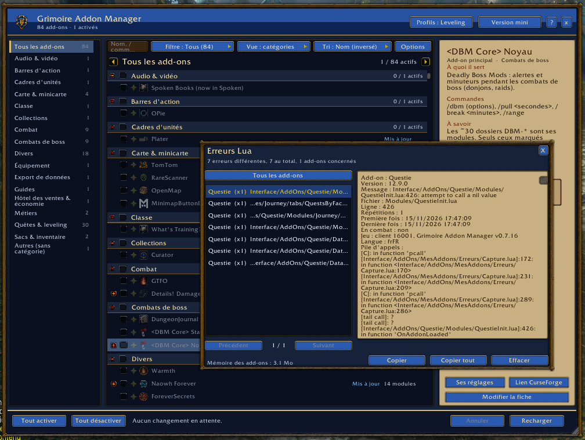

> 🌐 [🇬🇧 Read in English](../en/Errors-and-troubleshooting.md) · [🏠 Accueil](../Home.md)

# 🐞 Erreurs et dépannage

*La fenêtre des erreurs.*

## 🐞 La fenêtre des erreurs
GAM attrape les erreurs Lua de **tous** tes add-ons. Ouvre la fenêtre avec `/gam erreurs`.
- Les erreurs sont rangées **par add-on**, avec la date, le nombre de fois, le fichier et la ligne.
- Choisis-en une pour lire sa pile d'appels complète (le chemin qui mène à l'erreur).
- **Copier** copie une erreur, **Tout copier** toutes : colle-les à la personne qui t'aide.
- **Effacer** vide la liste (`/gam erreurs effacer`).
- Le bouton de la minicarte montre un petit **compteur rouge** quand il y a des erreurs.
- Ce qui se passe à une nouvelle erreur (fenêtre, une ligne dans le chat, rien), un son, et le masquage de la fenêtre rouge du jeu : Options › Erreurs.

## 🧠 La mémoire
`/gam memoire` classe les add-ons du plus gourmand au plus sobre. GAM te **prévient** aussi quand le total ou un seul add-on dépasse un seuil (Options › Erreurs, avancé).

## ⏱️ Le processeur
1. `/gam cpu activer`, puis `/reload` (le jeu est un peu plus lent pendant la mesure).
2. Joue un moment.
3. `/gam cpu` affiche le classement. `/gam cpu zero` recommence à zéro.
4. À la fin : `/gam cpu couper` et `/reload`.

## 🔎 Le mode dépannage : trouver l'add-on qui casse tout
1. `/gam depannage` éteint tout sauf GAM et tes add-ons verrouillés. Tu peux citer ceux à garder : `/gam depannage Questie Baganator`.
2. `/reload` et teste. Le problème a disparu ? Rallume la moitié de tes add-ons, recharge, recommence avec la moitié coupable.
3. `/gam retour` remet **tout exactement comme avant**, même après plusieurs rechargements. Recharge encore.

## 🧪 L'essai
`/gam essai NomDeLAddon` allume un add-on pour **une session seulement** : il s'éteint tout seul à la connexion suivante. Il reçoit un badge *Essai*. `/gam essai` seul donne la liste.

## ⏳ Les add-ons périmés
Un add-on fait pour une autre version du jeu est marqué « périmé » et n'est pas chargé. Pour le charger quand même, à tes risques : `/gam perimes on` (puis recharge) ; `/gam perimes off` pour arrêter.

## 🩺 `/gam diag` et `/gam trace`
Des outils pour celui qui répare GAM :
- `/gam diag` vérifie ce que le jeu sait faire (fonctions, images, réglages) et note le résultat.
- `/gam trace` note la place de chaque morceau de la fenêtre à chaque clic, pour déboguer ; retape-la pour arrêter.

Les deux écrivent dans ta sauvegarde au prochain `/reload` ou à la déconnexion ; donne ce journal à la personne qui t'aide.

## 🧰 Problèmes courants
| Problème | Quoi faire |
|---|---|
| La fenêtre ne s'ouvre pas | Vérifie que GAM est coché sur l'écran des personnages ; essaie `/maa` ou `/mesaddons` (un autre add-on a peut-être pris `/gam`) ; utilise le bouton de la minicarte ou Échap › AddOns ; s'il est « périmé », coche *Charger les add-ons périmés* sur l'écran des add-ons. Vérifie que le chemin est `AddOns\GrimoireAddonManager\GrimoireAddonManager.toc` (pas de dossier en trop au milieu). |
| J'ai coché mais rien n'a changé | Clique **Recharger**. C'est normal. |
| Un add-on ne se charge pas | Lis la raison sur sa ligne (dépendance absente, périmé, non prévu pour Forever). Maj + clic sur sa case allume aussi ses dépendances. |
| Le jeu rame | `/gam memoire`, puis `/gam cpu activer`. Éteins les gros consommateurs, ou fais un profil « léger ». |
| La fenêtre s'affiche mal | Options › Fenêtre : taille du texte ; Options › Fiches : fond de la fiche « uni » ; avancé : *Oublier les tailles gardées*. |
| Un profil a éteint un add-on dont j'ai besoin | `/gam annuler` avant de recharger. Pour toujours : verrouille cet add-on, ou ajoute-le au profil puis *Garder l'état actuel ici*. |

Toujours bloqué ? Vois la [FAQ](FAQ.md).
