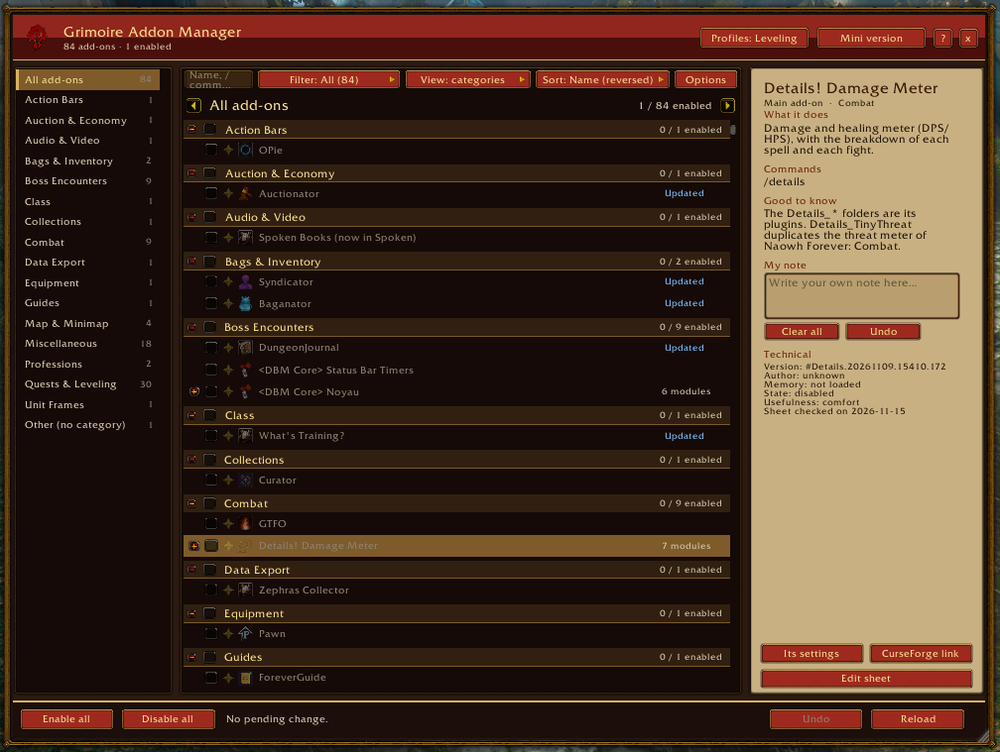
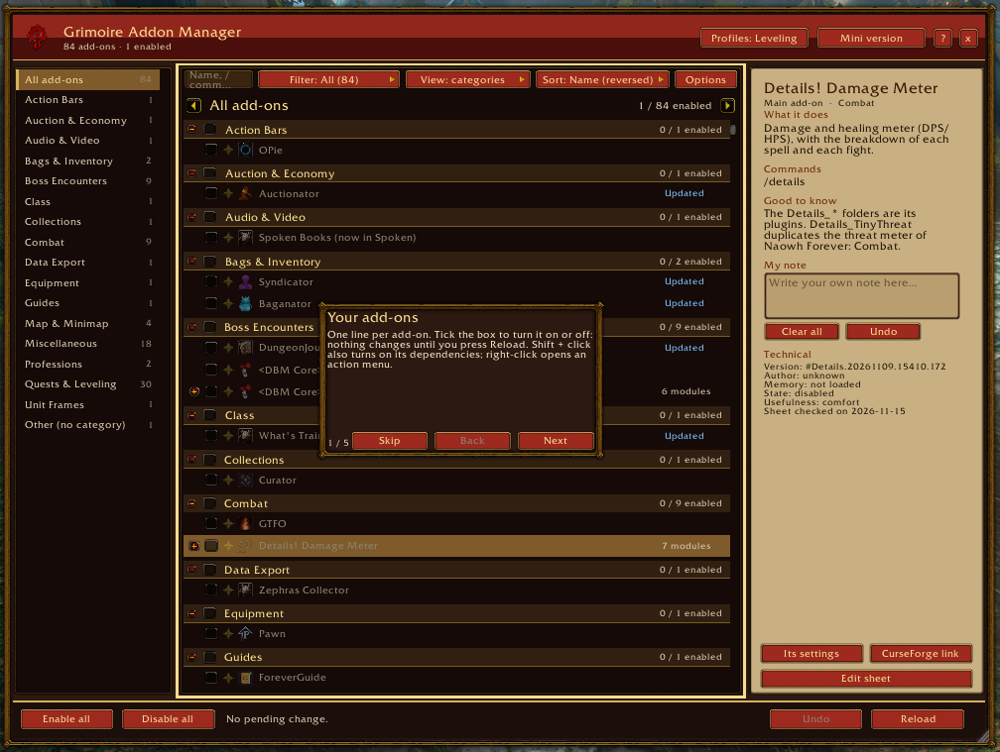

> 🌐 [🇬🇧 Read in English](../en/Getting-started.md) · [🏠 Accueil](../Home.md)

# 🚀 Prise en main

*La fenêtre Grimoire : les catégories à gauche, tes add-ons au milieu, la fiche à droite.*

## 📥 Installer
- **CurseForge** (le plus simple) : cherche *Grimoire Addon Manager*.
- **À la main** : télécharge le dernier zip et copie le dossier `GrimoireAddonManager` dans `World of Warcraft\_forever_\Interface\AddOns\`.
- Lance le jeu et vérifie, sur l'écran des personnages (bouton AddOns), que **Grimoire Addon Manager** est coché.

Tes réglages, profils et notes sont gardés par le jeu dans `WTF\Account\…\SavedVariables\`, **pas** dans le dossier de l'add-on : mettre à jour ou réinstaller GAM ne les efface jamais.

## 📖 Ouvrir la fenêtre
Au choix :
- tape **/gam** dans le chat (`/maa` et `/mesaddons` font pareil ; tu peux changer ces noms dans les [Options](Options.md)) ;
- clique le **bouton rond près de la minicarte** (glisse-le pour le déplacer) ;
- ouvre le **menu Échap** du jeu et clique le bouton **AddOns** ;
- donne-lui une touche : Échap › Raccourcis › AddOns › *Grimoire Addon Manager* (cinq touches : fenêtre, profils, recharger, antisèche, version mini).

## ✅ Cocher, puis Recharger
1. **Coche** la case d'un add-on pour l'allumer, **décoche** pour l'éteindre.
2. Rien ne change encore. Le jeu ne charge ou ne décharge les add-ons qu'au redémarrage de l'interface.
3. Clique **Recharger** en bas. Le bouton s'allume (avec un compteur) dès que quelque chose attend.
4. Tu as changé d'avis ? **Annuler** (avant de recharger) reprend le dernier changement.

> 💡 « Coché » veut dire *sera allumé au prochain rechargement*. « Chargé » veut dire *tourne maintenant*. La ligne le dit en clair.

## 🧭 Premiers pas
- Survole un add-on : un petit résumé apparaît. Clique-le : sa [fiche](Sheets.md) complète s'ouvre à droite.
- Clique **Profils** en haut pour changer d'un coup tout un jeu d'add-ons ([Profils](Profiles.md)).
- Clique **?** en haut pour l'antisèche de toutes les commandes ; tape `/gam visite` pour la visite guidée en 5 bulles.

*La visite guidée montre les parties principales de la fenêtre en 5 bulles.*

Suite : [La fenêtre](The-window.md).
