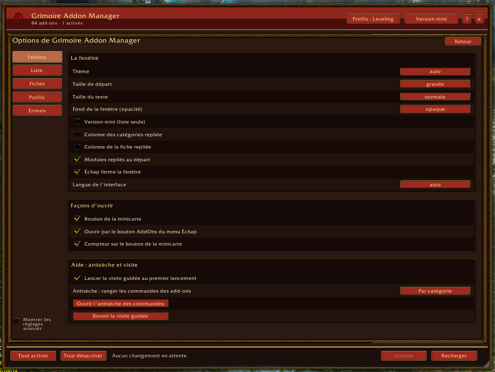
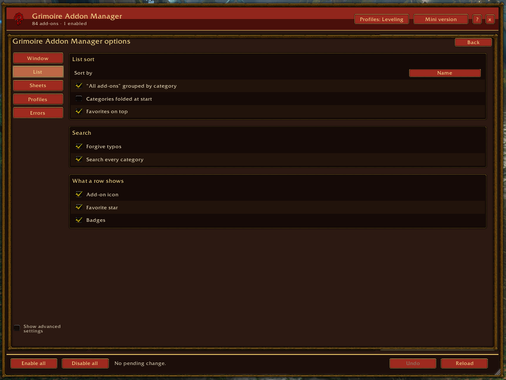
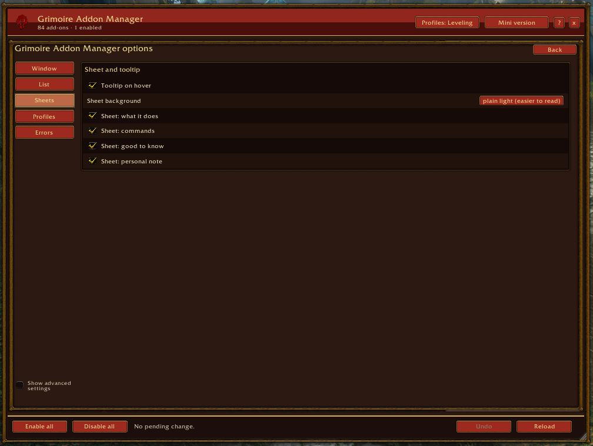
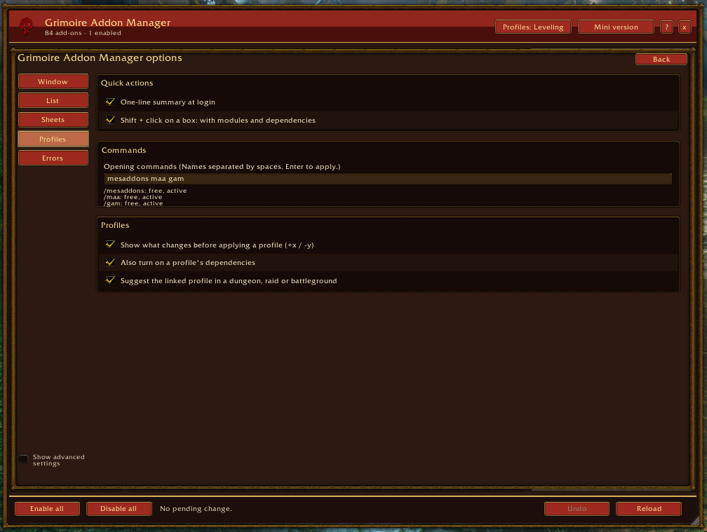
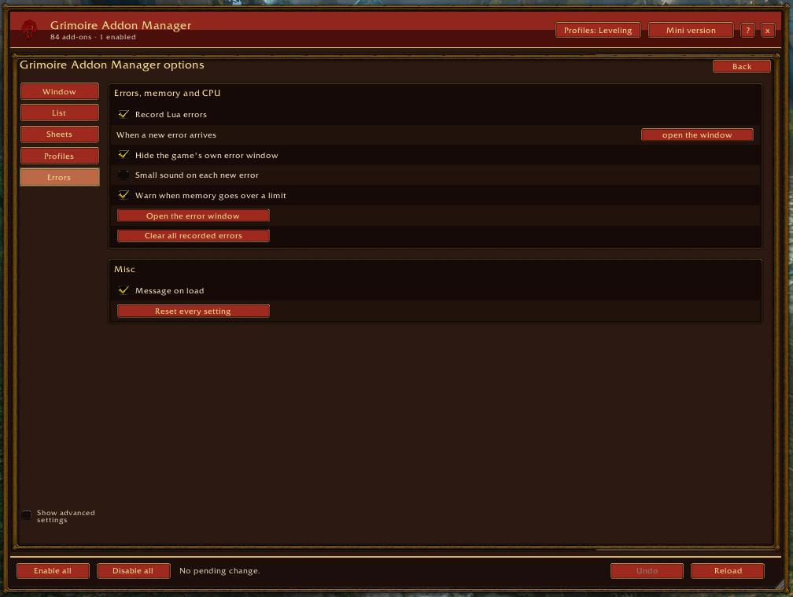

> 🌐 [🇬🇧 Read in English](../en/Options.md) · [🏠 Accueil](../Home.md)

# ⚙️ Options

Tout ce qui suit est généré depuis les fichiers de données de l'add-on. Les options marquées 🔧 n'apparaissent que si tu coches **Montrer les réglages avancés** en haut du panneau d'options.

> 📍 Ouvre-les par le bouton **Options** de la fenêtre, `/gam options`, ou le menu Échap › Options › AddOns du jeu (`/gam options jeu`).

## 🪟 Fenêtre

### La fenêtre

| Option | À quoi ça sert | Au départ | Avancée |
|---|---|---|---|
| Thème | Les couleurs de la fenêtre. « auto » suit la faction de ton personnage (rouge et or pour la Horde, bleu pour l'Alliance). **Choix :** auto, horde, alliance, neutre. | auto | — |
| Taille de départ | Taille de la fenêtre à la première ouverture (tu peux ensuite tirer son coin en bas à droite). **Choix :** grande, moyenne, compacte. | grande | — |
| Taille du texte | Rend tout le texte de la fenêtre plus petit ou plus grand. **Choix :** petite, normale, grande. | normale | — |
| Police | Police de caractères de la fenêtre : celle du jeu, une gothique ou Cinzel. **Choix :** jeu, gothique, cinzel. | jeu | 🔧 oui |
| Fond de la fenêtre (opacité) | Plus ou moins de transparence pour le fond de la fenêtre. **Choix :** opaque, 85 %, 70 %, transparent (50 %). | opaque | — |
| Version mini (liste seule) | Ne garde que la liste, pour cocher vite. Comme le bouton Version mini de l'en-tête. | ⬜ non | — |
| Colonne des catégories repliée | Replie la colonne de gauche (catégories). Comme la flèche du bandeau. | ⬜ non | — |
| Colonne de la fiche repliée | Replie la colonne de droite (la fiche). Comme la flèche du bandeau. | ⬜ non | — |
| Étapes d'annulation gardées | Combien de changements le bouton Annuler peut défaire. (de 1 à 20) | 5 | 🔧 oui |
| Modules repliés au départ | Les modules d'un gros add-on sont cachés sous lui au départ. | ✅ oui | — |
| Échap ferme la fenêtre | La touche Échap ferme la fenêtre. | ✅ oui | — |
| Langue de l'interface | Langue de l'interface. « auto » suit la langue du jeu. **Choix :** auto, Français, English. | auto | — |
| 🔘 Oublier les tailles gardées | Oublie la taille et la place gardées des fenêtres. | (bouton) | 🔧 oui |

### Façons d'ouvrir

| Option | À quoi ça sert | Au départ | Avancée |
|---|---|---|---|
| Bouton de la minicarte | Affiche le bouton rond près de la minicarte. Clic : ouvre ; clic droit : menu ; glisser : le déplacer. | ✅ oui | — |
| Ouvrir par le bouton AddOns du menu Échap | Le bouton « AddOns » du menu Échap du jeu ouvre GAM. | ✅ oui | — |
| Place du bouton (degrés) | Place du bouton autour de la minicarte, en degrés (le glisser change aussi cette valeur). (de 0 à 359) | 200 | 🔧 oui |
| Compteur sur le bouton de la minicarte | Petit compteur rouge sur le bouton quand il y a des erreurs (ou des changements en attente). | ✅ oui | — |
| Clic droit sur le bouton | Ce que fait le clic droit sur le bouton de la minicarte. **Choix :** Menu (profils et outils), Recharger si des changements attendent. | Menu (profils et outils) | 🔧 oui |
| Profils dans le menu du bouton | Met tes profils dans le menu du clic droit du bouton. | ✅ oui | 🔧 oui |

### Aide : antisèche et visite

| Option | À quoi ça sert | Au départ | Avancée |
|---|---|---|---|
| Lancer la visite guidée au premier lancement | Lance la visite guidée en 5 bulles au premier lancement. Une seule fois. | ✅ oui | — |
| Contenu de l'antisèche à l'ouverture | Ce que l'antisèche montre à l'ouverture : tout, seulement les commandes de GAM, ou seulement celles de tes add-ons. **Choix :** Tout, Ce gestionnaire, Mes add-ons installés. | Tout | 🔧 oui |
| Antisèche : ranger les commandes des add-ons | Comment les commandes des add-ons sont rangées dans l'antisèche. **Choix :** Par catégorie, Un onglet par add-on. | Par catégorie | — |
| Maj + clic sur une commande de l'antisèche : la lancer | Maj + clic sur une commande de l'antisèche la lance au lieu de seulement l'écrire. | ✅ oui | 🔧 oui |
| Montrer aussi les commandes des add-ons éteints | Liste aussi les commandes des add-ons éteints. | ✅ oui | 🔧 oui |
| Repérer les commandes que les fiches ne citent pas | Repère les commandes que des add-ons déclarent mais que les fiches ne citent pas. | ✅ oui | 🔧 oui |
| 🔘 Ouvrir l'antisèche des commandes | Ouvre l'antisèche des commandes. | (bouton) | — |
| 🔘 Revoir la visite guidée | Rejoue la visite guidée. | (bouton) | — |

## 📋 Liste

### Tri de la liste

| Option | À quoi ça sert | Au départ | Avancée |
|---|---|---|---|
| Trier par | Le tri de la liste. Clique le bouton de tri pour le changer ; clic droit pour l'inverser. **Choix :** Nom, Catégorie, État, Mémoire, Utilité. | Nom | — |
| Ordre inversé | Inverse l'ordre du tri. | ⬜ non | 🔧 oui |
| « Tous les add-ons » rangé par catégories | Dans « Tous les add-ons », range les add-ons par catégories repliables (décoché = une simple liste). | ✅ oui | — |
| Catégories repliées au départ | Les sections de catégories sont repliées au départ. | ⬜ non | — |
| Favoris en haut | Les favoris (étoile) restent en haut de la liste. | ✅ oui | — |
| Nouveaux en haut | Les add-ons qui viennent d'arriver passent devant. | ✅ oui | 🔧 oui |
| « Nouveau » seulement sans fiche | Seuls les add-ons sans fiche reçoivent le badge « Nouveau ». | ✅ oui | 🔧 oui |

### Choix de la liste Filtre

| Option | À quoi ça sert | Au départ | Avancée |
|---|---|---|---|
| Dans la liste Filtre : « Tous » | Garde le choix « Tous » dans la liste déroulante Filtre de la fenêtre. | ✅ oui | 🔧 oui |
| Dans la liste Filtre : « Activés » | Garde le choix « Activés » dans la liste déroulante Filtre de la fenêtre. | ✅ oui | 🔧 oui |
| Dans la liste Filtre : « Désactivés » | Garde le choix « Désactivés » dans la liste déroulante Filtre de la fenêtre. | ✅ oui | 🔧 oui |
| Dans la liste Filtre : « Périmés » | Garde le choix « Périmés » dans la liste déroulante Filtre de la fenêtre. | ✅ oui | 🔧 oui |
| Dans la liste Filtre : « Doublons » | Garde le choix « Doublons » dans la liste déroulante Filtre de la fenêtre. | ✅ oui | 🔧 oui |
| Dans la liste Filtre : « Sans fiche » | Garde le choix « Sans fiche » dans la liste déroulante Filtre de la fenêtre. | ✅ oui | 🔧 oui |
| Dans la liste Filtre : « Favoris » | Garde le choix « Favoris » dans la liste déroulante Filtre de la fenêtre. | ✅ oui | 🔧 oui |
| Dans la liste Filtre : « À désinstaller » | Garde le choix « À désinstaller » dans la liste déroulante Filtre de la fenêtre. | ⬜ non | 🔧 oui |
| Dans la liste Filtre : « Nouveaux » | Garde le choix « Nouveaux » dans la liste déroulante Filtre de la fenêtre. | ✅ oui | 🔧 oui |
| Dans la liste Filtre : « Mis à jour » | Garde le choix « Mis à jour » dans la liste déroulante Filtre de la fenêtre. | ⬜ non | 🔧 oui |
| Dans la liste Filtre : « Erreurs » | Garde le choix « Erreurs » dans la liste déroulante Filtre de la fenêtre. | ⬜ non | 🔧 oui |
| Dans la liste Filtre : « En essai » | Garde le choix « En essai » dans la liste déroulante Filtre de la fenêtre. | ⬜ non | 🔧 oui |
| Dans la liste Filtre : « Modifiés » | Garde le choix « Modifiés » dans la liste déroulante Filtre de la fenêtre. | ⬜ non | 🔧 oui |

### Recherche

| Option | À quoi ça sert | Au départ | Avancée |
|---|---|---|---|
| Chercher dans le nom | La recherche regarde dans les noms. | ✅ oui | 🔧 oui |
| Chercher dans la fiche | La recherche regarde dans le texte des fiches. | ✅ oui | 🔧 oui |
| Chercher dans ma note | La recherche regarde dans tes notes perso. | ✅ oui | 🔧 oui |
| Chercher dans les commandes | La recherche regarde dans les commandes des add-ons (ex. /way). | ✅ oui | 🔧 oui |
| Chercher dans les étiquettes | La recherche regarde dans les étiquettes (#pvp…). | ✅ oui | 🔧 oui |
| Chercher dans le texte de l'add-on | La recherche regarde dans la description que l'add-on donne de lui-même. | ✅ oui | 🔧 oui |
| Chercher dans la catégorie | La recherche regarde dans les noms de catégories. | ✅ oui | 🔧 oui |
| Tolérer les fautes de frappe | Les petites fautes de frappe trouvent quand même l'add-on (« Questei » trouve Questie). | ✅ oui | — |
| Fautes tolérées par mot | Combien de lettres fausses sont pardonnées dans un mot. (de 0 à 3) | 1 | 🔧 oui |
| Longueur minimale pour tolérer | Les mots plus courts que ça doivent être tapés exactement. (de 2 à 8) | 4 | 🔧 oui |
| Chercher dans toutes les catégories | Une recherche regarde dans toutes les catégories, pas seulement celle choisie. | ✅ oui | — |
| Meilleurs résultats d'abord | Les meilleurs résultats passent devant, au lieu de suivre le tri normal. | ✅ oui | 🔧 oui |
| Garder la recherche au rechargement | Garde ce que tu as tapé dans la recherche après un rechargement. | ⬜ non | 🔧 oui |

### Ce qui s'affiche sur une ligne

| Option | À quoi ça sert | Au départ | Avancée |
|---|---|---|---|
| Icône de l'add-on | Montre l'icône de chaque add-on sur sa ligne. | ✅ oui | — |
| Étoile des favoris | Montre l'étoile des favoris sur chaque ligne. | ✅ oui | — |
| Badges | Montre les badges (nouveau, erreur…) sur chaque ligne. | ✅ oui | — |
| Pourquoi il ne se charge pas | Dit en clair pourquoi un add-on ne se charge pas (dépendance absente, périmé…). | ✅ oui | 🔧 oui |
| Dire aussi « chargé » ou « désactivé » | Écrit aussi « chargé » ou « désactivé » sur chaque ligne. | ⬜ non | 🔧 oui |
| Mémoire utilisée | Montre la mémoire utilisée par chaque add-on sur sa ligne. | ⬜ non | 🔧 oui |
| Badges par ligne (au plus) | Nombre maximal de badges sur une ligne (0 = aucun). (de 0 à 6) | 2 | 🔧 oui |
| Étiquettes par add-on (au plus) | Nombre maximal d'étiquettes pour un add-on. (de 1 à 20) | 8 | 🔧 oui |

### Badges

| Option | À quoi ça sert | Au départ | Avancée |
|---|---|---|---|
| Badge « Nouveau » | Badge pour un add-on qui vient d'arriver dans ton dossier AddOns. | ✅ oui | 🔧 oui |
| Badge « Mis à jour » | Badge pour un add-on dont la version a changé depuis la dernière fois. | ✅ oui | 🔧 oui |
| Badge « Erreur » | Badge pour un add-on qui a causé au moins une erreur Lua. | ✅ oui | 🔧 oui |
| Badge « Doublon » | Badge quand un autre add-on allumé fait la même chose. | ✅ oui | 🔧 oui |
| Badge « Inutile » | Badge pour un add-on non prévu pour WoW Forever (grisé). | ✅ oui | 🔧 oui |
| Badge « Essai » | Badge pour un add-on allumé pour cette session seulement. | ✅ oui | 🔧 oui |
| Badge « À retirer » | Badge pour un add-on de ta liste « à retirer » (un pense-bête). | ✅ oui | 🔧 oui |
| Badge « Verrou » | Badge pour un add-on verrouillé (aucun profil ne l'éteindra). | ✅ oui | 🔧 oui |
| 🔘 Marquer tout comme vu | Retire les badges « Nouveau » et « Mis à jour » de tous les add-ons. | (bouton) | 🔧 oui |

## 📜 Fiches

### La fiche et l'infobulle

| Option | À quoi ça sert | Au départ | Avancée |
|---|---|---|---|
| Infobulle au survol | Montre un petit résumé en infobulle quand tu survoles un add-on. | ✅ oui | — |
| Fond de la fiche | Fond de la fiche : uni clair (le plus lisible) ou la texture de parchemin du jeu. **Choix :** parchemin du jeu, uni clair (plus lisible). | uni clair (plus lisible) | — |
| Fiche : à quoi il sert | Montre la partie « à quoi il sert » de la fiche. | ✅ oui | — |
| Fiche : commandes | Montre les commandes de l'add-on dans la fiche. | ✅ oui | — |
| Fiche : à savoir | Montre la partie « à savoir » (pièges, réglages à faire). | ✅ oui | — |
| Fiche : note perso | Montre la zone de ta note perso dans la fiche. | ✅ oui | — |
| Fiche : technique | Montre la version, l'auteur, la mémoire et l'état. | ✅ oui | 🔧 oui |
| Fiche : dépendances | Montre les add-ons dont celui-ci a besoin, et s'ils sont là et allumés. | ✅ oui | 🔧 oui |
| Fiche : doublons | Montre les add-ons allumés qui font la même chose. | ✅ oui | 🔧 oui |
| Fiche : badges | Montre les mêmes badges que sur la ligne. | ✅ oui | 🔧 oui |
| Longueur d'une note | Longueur maximale d'une note perso, en signes. (de 100 à 5000) | 1000 | 🔧 oui |
| Longueur d'un texte de fiche | Longueur maximale d'un texte quand tu modifies une fiche, en signes. (de 100 à 5000) | 800 | 🔧 oui |

## 🎒 Profils

### Profils

| Option | À quoi ça sert | Au départ | Avancée |
|---|---|---|---|
| Montrer ce qui change avant d'appliquer un profil (+x / -y) | Avant d'appliquer un profil, montre ce qui change : +x à allumer, −y à éteindre. | ✅ oui | — |
| Activer aussi les dépendances d'un profil | Un profil allume aussi les dépendances dont ses add-ons ont besoin. | ✅ oui | — |
| Activer aussi les dépendances facultatives (ex. Baganator active Syndicator) | Allume aussi les dépendances facultatives (ex. Baganator amène Syndicator). | ⬜ non | 🔧 oui |
| Appliquer un profil à | À qui un profil s'applique par défaut : ce personnage ou tous ceux qu'on connaît. **Choix :** Ce personnage, Tous les personnages. | Ce personnage | 🔧 oui |
| Proposer le profil associé en donjon, raid ou champ de bataille | Propose le profil associé en entrant en donjon, raid ou champ de bataille. Jamais automatique : il demande d'abord et attend la fin du combat. | ✅ oui | — |
| Attendre (secondes) avant de proposer | Secondes d'attente après l'entrée avant de proposer. (de 0 à 30) | 3 | 🔧 oui |
| Profil proposé en donjon (nom) | Nom du profil proposé en donjon. | `donjon` | 🔧 oui |
| Profil proposé en raid (nom) | Nom du profil proposé en raid. | `donjon` | 🔧 oui |
| Profil proposé en champ de bataille (nom) | Nom du profil proposé en champ de bataille ou arène (vide = pas de proposition). | (vide) | 🔧 oui |

### Actions rapides

| Option | À quoi ça sert | Au départ | Avancée |
|---|---|---|---|
| Résumé d'une ligne à la connexion | Écrit une ligne dans le chat à la connexion : add-ons, profil, changements en attente, erreurs. | ✅ oui | — |
| Maj + clic sur une case : avec modules et dépendances | Maj + clic sur une case allume aussi les modules et les dépendances de l'add-on. | ✅ oui | — |
| Dire quels essais se terminent | À la connexion, dit quels add-ons en essai viennent de s'éteindre. | ✅ oui | 🔧 oui |

### Commandes

| Option | À quoi ça sert | Au départ | Avancée |
|---|---|---|---|
| Commandes d'ouverture | Les mots qui ouvrent la fenêtre (/gam, /maa, /mesaddons…), séparés par des espaces. Un nom déjà pris par un autre add-on est refusé. | /mesaddons /gam /maa | — |
| Commande seule | Ce que fait la commande tapée seule : ouvrir la fenêtre, afficher l'aide ou ouvrir les options. **Choix :** ouvrir, aide, options. | ouvrir | 🔧 oui |

## 🐞 Erreurs

### Erreurs, mémoire et processeur

| Option | À quoi ça sert | Au départ | Avancée |
|---|---|---|---|
| Noter les erreurs Lua | Attrape les erreurs Lua de tous les add-ons et garde leurs détails. | ✅ oui | — |
| Quand une nouvelle erreur arrive | Ce qui se passe quand une nouvelle erreur arrive : ouvrir la fenêtre, une ligne dans le chat, ou rien. **Choix :** ouvrir la fenêtre, une ligne dans le chat, rien (compter en silence). | ouvrir la fenêtre | — |
| Secondes entre deux annonces | Attente minimale entre deux annonces, pour ne pas être submergé. (de 0 à 120) | 10 | 🔧 oui |
| Cacher la fenêtre d'erreur du jeu | Cache la fenêtre rouge d'erreur du jeu ; les erreurs restent notées ici. | ✅ oui | — |
| Petit son à chaque nouvelle erreur | Joue un petit son à chaque nouvelle erreur. | ⬜ non | — |
| Erreurs différentes gardées | Combien d'erreurs différentes sont gardées (les plus vieilles partent d'abord). (de 10 à 500) | 100 | 🔧 oui |
| Signes gardés du message | Signes gardés de chaque message d'erreur. (de 100 à 2000) | 500 | 🔧 oui |
| Signes gardés de la pile d'appels | Signes gardés de la pile d'appels de chaque erreur (le chemin qui y mène). (de 200 à 6000) | 1800 | 🔧 oui |
| Lignes de la liste d'erreurs | Lignes montrées dans la liste de la fenêtre des erreurs. (de 5 à 20) | 10 | 🔧 oui |
| Prévenir si la mémoire dépasse un seuil | Te prévient quand la mémoire dépasse les seuils ci-dessous. | ✅ oui | — |
| Seuil de mémoire totale (Mo) | Seuil d'alerte pour la mémoire de tous les add-ons ensemble. (de 100 à 4000) | 500 | 🔧 oui |
| Seuil de mémoire par add-on (Mo) | Seuil d'alerte pour un seul add-on. (de 10 à 1000) | 80 | 🔧 oui |
| Secondes entre deux mesures | Toutes les combien de secondes la mémoire est mesurée. (de 10 à 600) | 60 | 🔧 oui |
| Secondes avant de répéter une alerte | Attente avant de répéter la même alerte. (de 60 à 3600) | 900 | 🔧 oui |
| Lignes de la commande mémoire | Lignes écrites par /gam memoire. (de 3 à 50) | 10 | 🔧 oui |
| Rappeler que le mode mesure est allumé | Te rappelle que le mode mesure du processeur est allumé (il ralentit un peu le jeu). | ✅ oui | 🔧 oui |
| Lignes de la commande processeur | Lignes écrites par /gam cpu. (de 3 à 50) | 10 | 🔧 oui |
| 🔘 Ouvrir la fenêtre des erreurs | Ouvre la fenêtre des erreurs. | (bouton) | — |
| 🔘 Effacer toutes les erreurs notées | Efface toutes les erreurs notées. | (bouton) | — |

### Journal et personnages

| Option | À quoi ça sert | Au départ | Avancée |
|---|---|---|---|
| Journal actif | Allume le journal de l'add-on (ce que GAM a fait). | ✅ oui | 🔧 oui |
| Lignes gardées | Combien de lignes de journal sont gardées. (de 50 à 1000) | 200 | 🔧 oui |
| Niveau minimal | Importance minimale écrite dans le journal : debug, info, avertissement ou erreur. **Choix :** debug, info, avertissement, erreur. | info | 🔧 oui |
| Regrouper les lignes identiques | Les lignes identiques qui se suivent sont regroupées, avec un compteur. | ✅ oui | 🔧 oui |
| Noter les erreurs Lua | Écrit aussi les erreurs Lua dans le journal. | ✅ oui | 🔧 oui |
| Lignes montrées dans le chat | Combien de lignes du journal la commande /gam journal écrit dans le chat. (de 1 à 50) | 10 | 🔧 oui |
| Mémoriser mes personnages | Retient tes personnages pour appliquer un profil à tous. | ✅ oui | 🔧 oui |
| 🔘 Vider le journal | Vide le journal. | (bouton) | 🔧 oui |

### Divers

| Option | À quoi ça sert | Au départ | Avancée |
|---|---|---|---|
| Message au chargement | Écrit un petit message « chargé » dans le chat au lancement du jeu. | ✅ oui | — |
| Couleur du préfixe (hexadécimal) | Couleur du préfixe [GAM] dans les messages du chat, 6 chiffres hexadécimaux (ex. ffd100). | `ffd100` | 🔧 oui |
| 🔘 Remettre toutes les valeurs de départ | Remet tous les réglages à leur valeur de départ (demande confirmation). | (bouton) | — |
