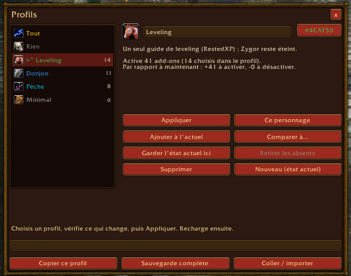

> 🌐 [Read in English](../en/Profiles.md) · [🏠 Accueil](../Home.md)

# 🎒 Les profils

Un profil est une liste d'add-ons à allumer ensemble. Les profils sont communs à tous tes personnages ; en l'appliquant tu choisis **Ce personnage** ou **Tous les personnages**.

*La fenêtre des profils : la liste à gauche, ce que le profil allume, et ce qui change.*

## 🎁 Les profils prêts
- **Leveling**, **Donjon**, **Pêche**, **Minimal** ;
- **Tout** et **Rien** : toujours là, impossibles à supprimer.

Seuls les add-ons vraiment installés sont gardés ; les modules suivent leur add-on principal. `/gam profil prets` recrée les profils prêts si tu les as supprimés.

## ▶️ Appliquer un profil
1. Clique **Profils** en haut de la fenêtre (ou `/gam profils`).
2. Choisis un profil : la fenêtre dit ce qu'il allume et **ce qui change : +x à allumer, −y à éteindre**.
3. Choisis **Ce personnage** ou **Tous les personnages**, puis **Appliquer** (une confirmation remontre le +x / −y).
4. Clique **Recharger** : c'est là que les add-ons changent vraiment.

Pour garder l'état actuel comme nouveau profil : **Nouveau (état actuel)**. Pour mettre un profil à jour : **Garder l'état actuel ici**. Tu peux aussi renommer, supprimer et nettoyer un profil (nettoyer retire les add-ons désinstallés depuis).

## 🔒 Les verrous
**Verrouille** un add-on (clic droit › Verrouiller, ou `/gam verrou Nom`) : aucun profil ne l'éteindra jamais.

## 🔗 Les dépendances
Un profil allume aussi les dépendances dont ses add-ons ont besoin. Les dépendances facultatives (ex. Baganator amène Syndicator) sont une option avancée.

## ⚖️ Comparer deux profils
`/gam profil comparer Donjon / Leveling` dit ce qui est seulement dans l'un, seulement dans l'autre, et en commun.

## 📋 Copier et coller (MAA1)
- **Copier ce profil** donne une ligne de texte qui commence par **MAA1**. Envoie-la à un ami.
- Ton ami utilise **Coller / importer** (ou `/gam profil importer MAA1:…`).
- `/gam profil sauvegarde` écrit **tout** (profils, verrous, notes, étiquettes, favoris) en une ligne : garde-la de côté.

## 🎛️ Toutes les commandes de profil
| Commande | Ce qu'elle fait |
|---|---|
| `/gam profil <nom>` | Applique à ce personnage |
| `/gam profil tous <nom>` | Applique à tous les personnages connus |
| `/gam profil fusionner <nom>` | Ajoute ses add-ons, n'éteint rien |
| `/gam profil comparer A / B` | Compare deux profils |
| `/gam profil nouveau <nom>` | Nouveau profil depuis l'état actuel |
| `/gam profil enregistrer <nom>` | Remplace un profil par l'état actuel |
| `/gam profil renommer ancien / nouveau` | Renomme |
| `/gam profil supprimer <nom>` | Supprime (définitif) |
| `/gam profil exporter <nom>` | Une ligne de texte MAA1 |

Les mots anglais marchent aussi (`/gam profile all Dungeon`…). Voir [Commandes](Commands.md).

## ⚡ Changer sans ouvrir la fenêtre
- **Clic droit sur le bouton de la minicarte** : la liste des profils.
- **Une macro** : crée une macro du jeu avec `/gam profil Donjon`, puis `/gam recharger` quand tu es prêt.
- **Une touche** : attribue *Profils* ou *Recharger* dans les Raccourcis du jeu.

## 🏰 Proposition en donjon, raid ou champ de bataille
En entrant dans l'un d'eux, GAM peut te **proposer** le profil associé. Il ne l'applique jamais tout seul et attend la fin du combat. Tu choisis quel profil va avec quel lieu dans Options › Profils (avancé).

Suite : [Commandes](Commands.md).
