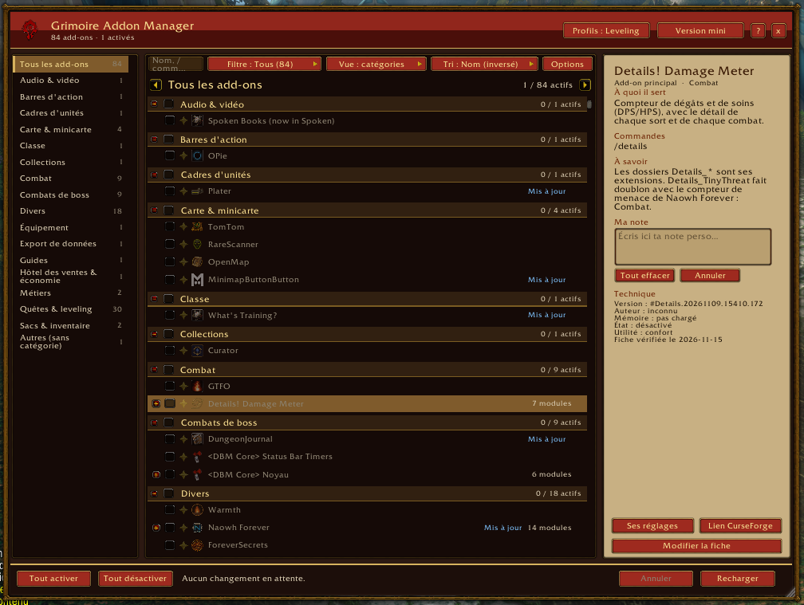
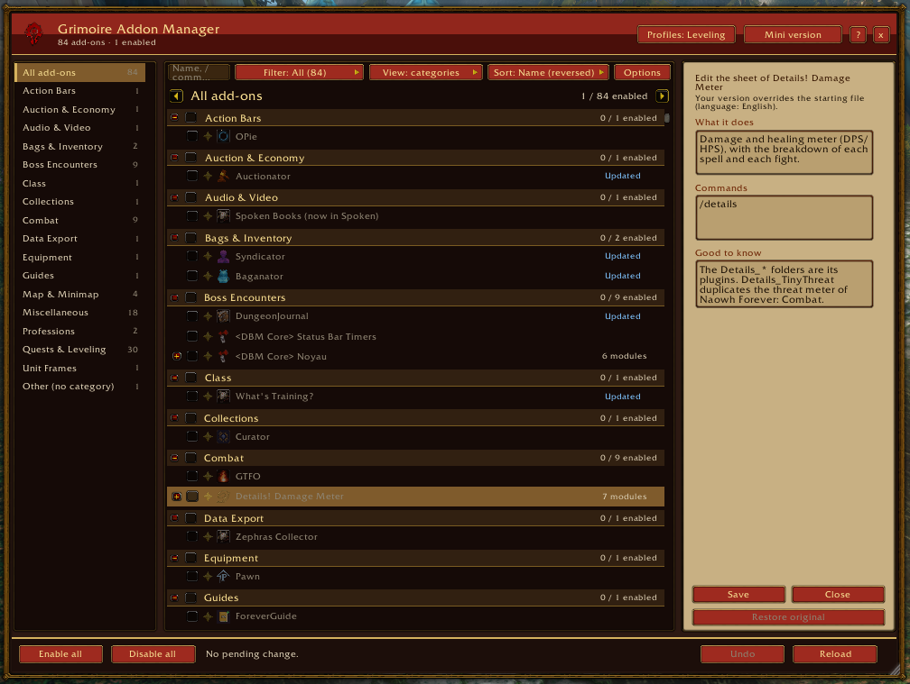

> 🌐 [🇬🇧 Read in English](../en/Sheets.md) · [🏠 Accueil](../Home.md)

# 📜 Les fiches et l'infobulle

GAM livre **102 fiches** : pour chaque add-on connu, à quoi il sert, ses commandes et ce qu'il faut savoir. Plus jamais « il sert à quoi, celui-là ? ».

*Une fiche, à droite de la liste.*

## 💬 L'infobulle
Survole une ligne pour voir le résumé et l'état. Tu peux la couper dans Options › Fiches › *Infobulle au survol*.

## 📜 La fiche
Clique une ligne : la fiche s'ouvre à droite.

| Partie | Ce qu'elle dit |
|---|---|
| **À quoi il sert** | Une ou deux phrases. |
| **Commandes** | Les commandes de l'add-on (ex. `/way` pour TomTom). |
| **À savoir** | Les pièges, les réglages à faire, ce qui ne marche pas sur Forever. |
| **Ta note** | Texte libre, gardé avec tes réglages. |
| **Technique** | Version, auteur, mémoire, état. |
| **Dépendances** | Les add-ons dont il a besoin, et s'ils sont là et allumés. |
| **Doublons** | Les add-ons allumés qui font la même chose. |
| **Badges** | Les mêmes que sur la ligne. |

Chaque partie se montre ou se cache dans Options › Fiches.

Un add-on **sans fiche** affiche sa propre description à la place. `/gam sansfiche` les liste.

## ✍️ Ta note perso
Tape dans la zone de note (« Écris ici ta note perso… »). Elle est gardée toute seule et la recherche la retrouve.
- **Tout effacer** vide la note ; **Annuler** la remet.
- Longueur maximale : Options › Fiches (avancé).

## ✏️ Modifier une fiche

Clique **Modifier la fiche** sous la fiche : change le texte, les commandes et les remarques. Ta version passe avant celle livrée. **Rétablir l'original** revient à la version de départ.

## 🔗 Les liens
- **Ses réglages** ouvre la page de réglages de l'add-on (s'il est chargé).
- **Lien CurseForge** montre son adresse à copier (le jeu ne peut pas ouvrir un navigateur).

Les fiches, catégories et profils livrés avec GAM sont dans des fichiers de données : voir [Pour les développeurs](For-developers.md) pour en ajouter pour tout le monde.

Suite : [Les profils](Profiles.md).
