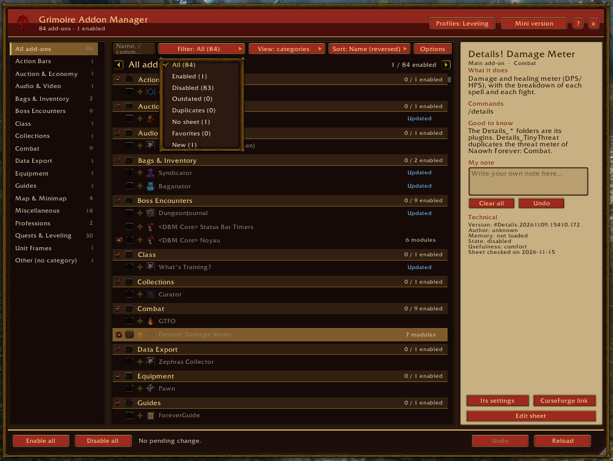
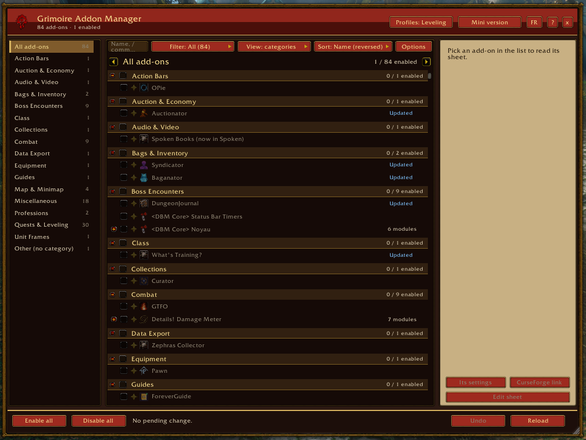
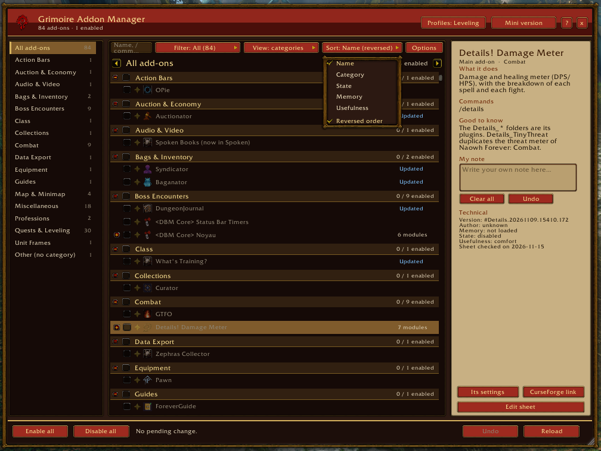
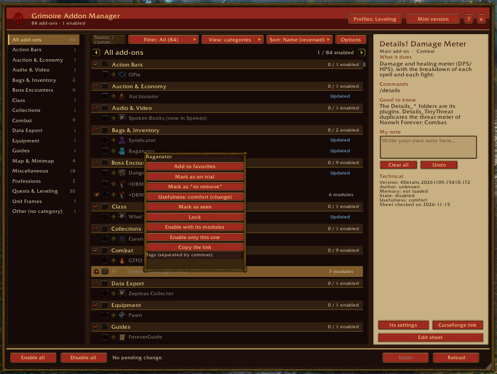
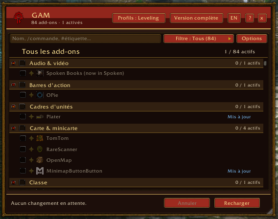

> 🌐 [Read in English](../en/The-window.md) · [🏠 Accueil](../Home.md)

# 📖 La fenêtre

*La liste Filtre, le bouton de tri et le bouton de vue dans la barre du haut (capture anglaise).*

## 🧩 Les trois colonnes
| Colonne | Ce qu'elle contient |
|---|---|
| **Gauche** | Les catégories (cartes, combat, sacs…). Clique-en une pour filtrer la liste. Les add-ons sans fiche vont dans « Autres ». |
| **Milieu** | Tes add-ons, une ligne chacun : case, icône, nom, étoile des favoris, badges, et l'état en clair. |
| **Droite** | La [fiche](Sheets.md) de l'add-on cliqué. |

Les **flèches « et »** du bandeau replient la colonne de gauche ou de droite pour donner plus de place à la liste. Un deuxième clic la remet, et le jeu s'en souvient.

## 🪟 Le haut de la fenêtre
- **En-tête** : le nom, le nombre d'add-ons et combien sont allumés. Attrape-le pour déplacer la fenêtre ; tire le coin en bas à droite pour la redimensionner.
- **Bouton de langue** (il affiche **EN** ou **FR**, la langue où tu passes) : un clic change la langue et recharge l'interface.

*La fenêtre en anglais, avec le bouton **FR** pour revenir au français.*

- **Profils**, **Version mini**, **?** (antisèche) et **✕** pour fermer. **Options** est à droite de la barre, sous le titre.
- Échap ferme aussi la fenêtre (tu peux le désactiver).

## 🗂️ Vue catégories ou vue liste
La liste déroulante **Vue** propose :
- **Vue : catégories** : « Tous les add-ons » rangé par catégories repliables ;
- **Vue : liste** : une simple liste.

## 🔍 Filtrer, trier, chercher
- **Filtre** (liste déroulante) : Tous, Activés, Désactivés, Périmés, Doublons, Sans fiche, Favoris, Nouveaux… Tu choisis les entrées proposées dans les [Options](Options.md).
- **Tri** (liste déroulante) : nom, catégorie, état, mémoire ou utilité ; **Ordre inversé** en bas de la liste.
- **Zone de recherche** : tape quelques lettres.
  - Les fautes de frappe sont tolérées (« Questei » trouve Questie).
  - Elle cherche dans les noms, les fiches, tes notes, les commandes et les étiquettes.
  - `/way` trouve les add-ons qui ont cette commande.
  - `#pvp` trouve les add-ons étiquetés *pvp*.
  - Plusieurs mots marchent ensemble.

*Les choix de tri (capture anglaise).*

## ⭐ Favoris, étiquettes et badges
- Clique l'**étoile** pour faire un favori ; les favoris restent en haut (option).
- Donne des **étiquettes** à un add-on par son menu clic droit (séparées par des virgules), puis cherche `#étiquette`.
- **Badges** sur une ligne :

| Badge | Sens |
|---|---|
| Nouveau | Vient d'arriver dans ton dossier AddOns |
| Mis à jour | Sa version a changé |
| Erreur | Il a causé au moins une erreur Lua |
| Doublon | Un autre add-on allumé fait la même chose |
| Inutile | Non prévu pour WoW Forever (grisé) |
| Essai | Allumé pour cette session seulement |
| À retirer | Dans ta liste « à désinstaller » (un pense-bête : GAM ne peut rien supprimer) |
| Verrou | Aucun profil ne l'éteindra |

## 🖱️ Les gestes de la souris
| Geste | Effet |
|---|---|
| Clic sur une case | Allume ou éteint l'add-on (après Recharger) |
| **Maj + clic** sur une case | L'allume **avec ses modules et ses dépendances** |
| Clic sur une ligne | Ouvre sa fiche |
| Survol d'une ligne | Infobulle avec le résumé et l'état |
| **Clic droit** sur une ligne | Menu d'actions rapides |
| Clic sur l'étoile | Favori oui / non |
| Clic / clic droit sur le tri | Change le tri / l'inverse |
| Clic sur le bouton de la minicarte | Ouvre ou ferme ; glisser pour le déplacer |
| Clic droit sur le bouton de la minicarte | Menu : profils, recharger, dépannage, périmés |

## 📋 Le menu clic droit

Il propose : ajouter aux favoris / retirer, marquer en essai, marquer « à désinstaller », niveau d'utilité, marquer comme vu, étiquettes, **Verrouiller / Déverrouiller**, **Activer avec ses modules**, **Activer seulement celui-ci**, **Copier le lien**.

## 🔘 Les boutons du bas
- **Tout activer** : coche tous les add-ons faits pour le jeu (puis Recharger).
- **Tout désactiver** : décoche tout sauf GAM (puis Recharger).
- **Annuler** : reprend le dernier changement (le nombre d'étapes gardées est une option).
- **Recharger** : applique tout.

Les deux boutons « tout » s'annulent.

## 📱 Version mini
Clique **Version mini** (ou `/gam mini`) : il ne reste que la liste, idéale pour cocher vite. Le même bouton, devenu **Version complète**, remet tout. La version mini garde la recherche, **Filtre**, **Options**, **Annuler** et **Recharger** ; le titre devient **GAM**.

*La version mini.*

Suite : [Les fiches](Sheets.md).
